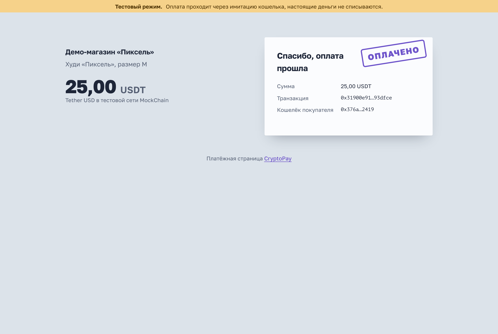
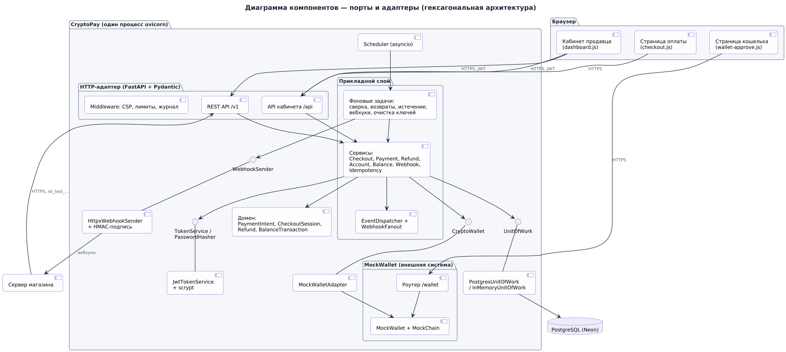

# CryptoPay — Stripe для криптовалюты

Платёжная система, которая принимает USDT, USDC, BTC и ETH так же, как Stripe принимает карты. Сервер магазина одним запросом создаёт страницу оплаты, покупатель платит криптокошельком, магазин получает подписанный вебхук. Модель объектов, REST API, идемпотентность и подпись вебхуков повторяют Stripe.

Кошелёк и блокчейн — **имитация MockWallet**, как тестовый режим Stripe: у каждого тестового кошелька заранее известный исход («Алиса» всегда платит, у «Боба» не хватает денег, у «Евы» транзакция падает в сети). Кошелёк подключён через порт `CryptoWallet` и адаптер, поэтому его можно заменить настоящим без изменения бизнес-логики.

> Учебный проект по дисциплине «Advanced Software» (мидтерм + файнал).

**Работающая версия:** https://cryptopay-u2rc.onrender.com · [проверка состояния](https://cryptopay-u2rc.onrender.com/healthz) · [Swagger UI](https://cryptopay-u2rc.onrender.com/docs) · [обозреватель MockChain](https://cryptopay-u2rc.onrender.com/wallet)



## Что где — по пунктам задания

| Пункт задания | Где |
|---|---|
| 1. ТЗ | [docs/TZ.md](docs/TZ.md) |
| 2. Диаграммы — всё, что прошли | [docs/diagrams.md](docs/diagrams.md) — 24 UML-диаграммы, исходники в `docs/diagrams/*.puml` |
| 3. Проект запущен на облачном сервере | **https://cryptopay-u2rc.onrender.com** · [docs/deployment.md](docs/deployment.md) — Render + Neon, `render.yaml`, `Dockerfile` |
| 4. Интеграция с криптокошельком | [docs/mock-wallet.md](docs/mock-wallet.md) — порт, адаптер, имитация кошелька и сети |
| 5. Где элементы SOLID | [docs/solid.md](docs/solid.md) |
| Отчёт | [docs/REPORT.md](docs/REPORT.md) |
| Шпаргалка к защите | [docs/DEFENSE.md](docs/DEFENSE.md) |
| Интерактивная карта проекта | [docs/project-map.html](docs/project-map.html) — открыть в браузере |

Ещё: [архитектура](docs/architecture.md) · [API](docs/api.md) · [тестирование](docs/testing.md) · [безопасность](docs/security.md)

## Запуск за минуту

Нужен Python 3.12 или новее. База данных не обязательна.

```bash
python -m venv .venv
source .venv/bin/activate          # Windows: .venv\Scripts\activate
pip install -r requirements.txt
pip install -e . --no-deps
python -m cryptopay
```

Откройте http://localhost:3000 и нажмите **«Попробовать оплату»**.

С PostgreSQL, как в production:

```bash
docker compose up --build
```

## Как попробовать

1. **Покупатель.** Главная → «Попробовать оплату» → «Оплатить» → в окне кошелька выберите **Алису** → «Подтвердить». Через ~10 секунд (3 блока по 3 секунды) появится печать «Оплачено».
2. **Неудачи.** Повторите с **Бобом** (недостаточно средств), **Кэрол** (кошелёк отклоняет), **Евой** (транзакция падает в сети) или нажмите «Отклонить». Платёж можно повторить другим кошельком.
3. **Продавец.** http://localhost:3000/dashboard → «Войти в демо-аккаунт» (`demo@cryptopay.dev` / `demo-password`). Платежи, частичные возвраты, баланс, события, ключи API и вебхуки.
4. **Сеть.** http://localhost:3000/wallet — обозреватель MockChain: блоки, балансы тестовых кошельков, транзакции.
5. **API.** http://localhost:3000/docs — Swagger UI.
6. **Магазин.** В кабинете → «Разработчикам» выпустите ключ и добавьте вебхук `http://localhost:4000/webhook`, затем:

   ```bash
   CRYPTOPAY_API_KEY=sk_test_… WEBHOOK_SECRET=whsec_… python examples/shop.py
   ```

   Откройте http://localhost:4000 → «Купить через CryptoPay» → оплатите → заказ отметится оплаченным по вебхуку.

## API в одном запросе

```bash
curl http://localhost:3000/v1/checkout/sessions \
  -u sk_test_…: \
  -H "Idempotency-Key: order-1042" \
  -H "Content-Type: application/json" \
  -d '{"amount": "25000000", "currency": "usdt", "description": "Худи «Пиксель»"}'
```

Ответ — объект `checkout.session` с `url`, на который нужно перенаправить покупателя. Суммы — в минимальных единицах: 25 USDT = `25000000`.

## Архитектура

```
cryptopay/
├── domain/            PaymentIntent, CheckoutSession, Refund, BalanceTransaction, деньги, события
├── application/       сервисы, порты (ABC), фоновые задачи, EventDispatcher
├── infrastructure/    FastAPI, PostgreSQL, память, httpx, JWT, scrypt, MockWalletAdapter
├── mockwallet/        имитация кошелька и сети — «внешняя система»
└── container.py       корень композиции
```



Зависимости направлены только внутрь (`infrastructure → application → domain`), и это проверяет тест `tests/test_architecture.py`.

## Тесты

```bash
pip install -r requirements-dev.txt
pytest                                   # 195 тестов без базы и браузера
TEST_DATABASE_URL=postgresql://… pytest  # + 16 контрактных тестов на PostgreSQL
RUN_E2E=1 pytest tests/e2e               # 10 сквозных тестов в Chromium
ruff check . && mypy                     # стиль и типы (--strict)
```

## Стек

Python 3.13 · FastAPI · Pydantic · PostgreSQL 16 (psycopg 3) · PyJWT · httpx · HTML + ES-модули без сборки · pytest · Playwright · Docker · Render · Neon · GitHub Actions · PlantUML

## Лицензия

MIT
