# Архитектура CryptoPay

CryptoPay устроен как маленький Stripe: у продавца есть секретный ключ, его сервер создаёт **страницу оплаты** (Checkout Session), покупатель платит, а продавец узнаёт об оплате из **вебхука**. Разница в том, что вместо банковских карт — криптокошелёк, а вместо настоящего блокчейна — имитация MockWallet (почему так — в [mock-wallet.md](mock-wallet.md)).

Этот документ отвечает на три вопроса: из каких частей состоит система, как эти части разговаривают друг с другом и почему всё устроено именно так.

## 1. Общая картина

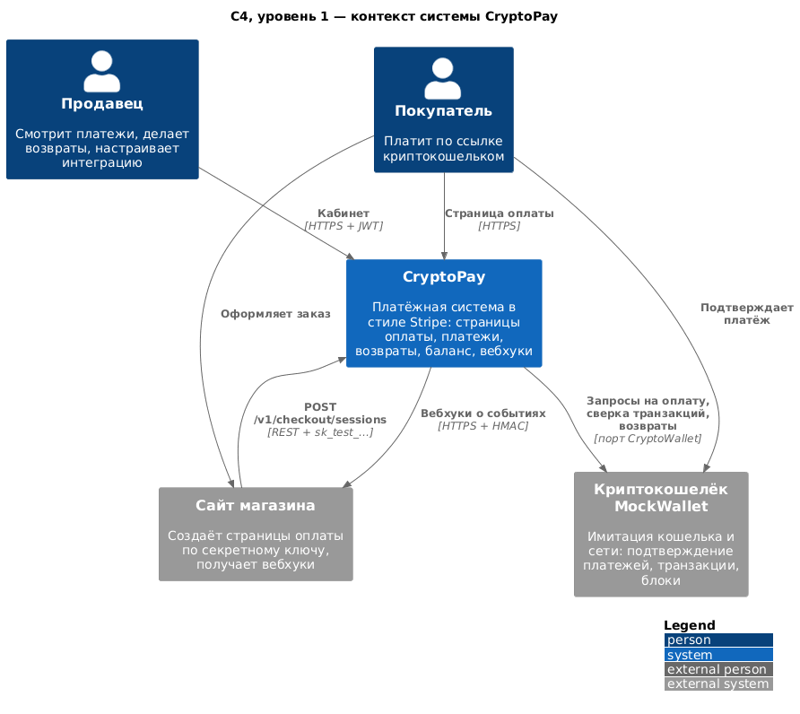

Вокруг CryptoPay пять участников:

- **Покупатель** — открывает страницу оплаты и подтверждает платёж в кошельке;
- **Продавец** — работает в личном кабинете: смотрит платежи, делает возвраты, выпускает ключи;
- **Сервер магазина** — создаёт страницы оплаты через REST API и принимает вебхуки (пример — `examples/shop.py`);
- **Криптокошелёк** (MockWallet) — подтверждает платежи и отправляет возвраты;
- **PostgreSQL** — хранит всё, что должно пережить перезапуск.

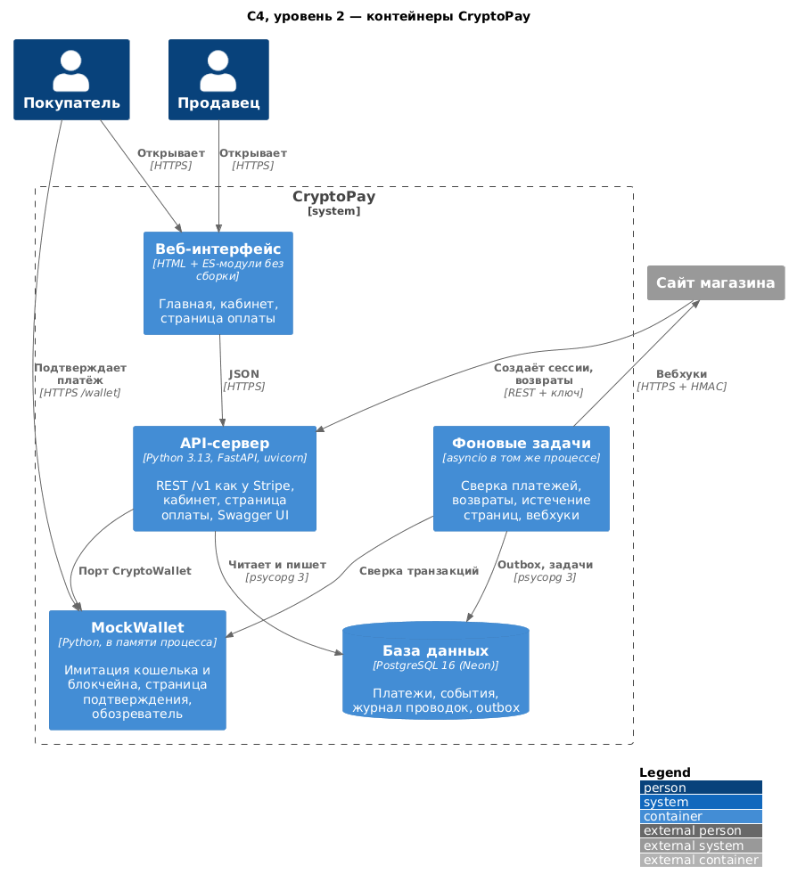

Технически это **один процесс** `uvicorn` с FastAPI. Внутри него живут REST API, страницы интерфейса (статические HTML + ES-модули без сборки), фоновые задачи на `asyncio` и имитатор кошелька. Один процесс — сознательный выбор: бесплатный план Render даёт одну машину, а для учебного проекта лишние сервисы только добавили бы точек отказа.

## 2. Слои и правило зависимостей

Код разложен по слоям гексагональной архитектуры («порты и адаптеры»):

```
cryptopay/
├── domain/            ← сущности и правила: PaymentIntent, CheckoutSession, Refund, деньги, события
├── application/       ← сценарии (сервисы), порты-интерфейсы, фоновые задачи, сериализатор
│   ├── ports/         ← ABC: репозитории, UnitOfWork, CryptoWallet, WebhookSender, Clock…
│   ├── services/      ← CheckoutService, PaymentService, RefundService, AccountService…
│   ├── events/        ← EventDispatcher (Observer) и WebhookFanout
│   └── jobs/          ← сверка платежей и возвратов, истечение страниц, доставка вебхуков
├── infrastructure/    ← адаптеры: FastAPI, PostgreSQL, память, httpx, JWT, scrypt, MockWalletAdapter
├── mockwallet/        ← «внешняя система»: имитация кошелька и сети, ничего не знает о CryptoPay
└── container.py       ← корень композиции: здесь и только здесь всё собирается вместе
```

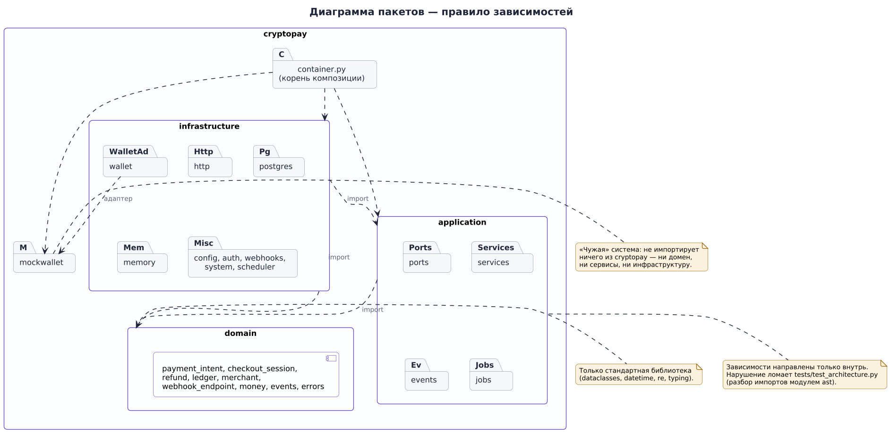

Правило одно: **зависимости направлены внутрь**.

| Слой | Может импортировать | Не может |
|---|---|---|
| `domain` | только себя и «чистую» стандартную библиотеку (`dataclasses`, `datetime`, `re`…) | FastAPI, Pydantic, psycopg, `os`, `logging`, `hashlib` |
| `application` | `domain` и себя | любые библиотеки ввода-вывода |
| `infrastructure` | всё | — |
| `mockwallet` | только себя | ничего из `cryptopay.*` |

Это не пожелание, а **тест**: `tests/test_architecture.py` разбирает импорты каждого файла через `ast` и падает, если правило нарушено (43 проверки). Попробуйте добавить `import fastapi` в `domain/payment_intent.py` — сборка в CI станет красной.

Что это даёт на практике:

- доменную логику можно проверять за миллисекунды, без базы и HTTP (61 unit-тест домена);
- PostgreSQL заменяется хранением в памяти одной строкой в `container.py` — и все сервисы работают так же;
- имитатор кошелька заменяется настоящим кошельком новым адаптером, сервисы не меняются.

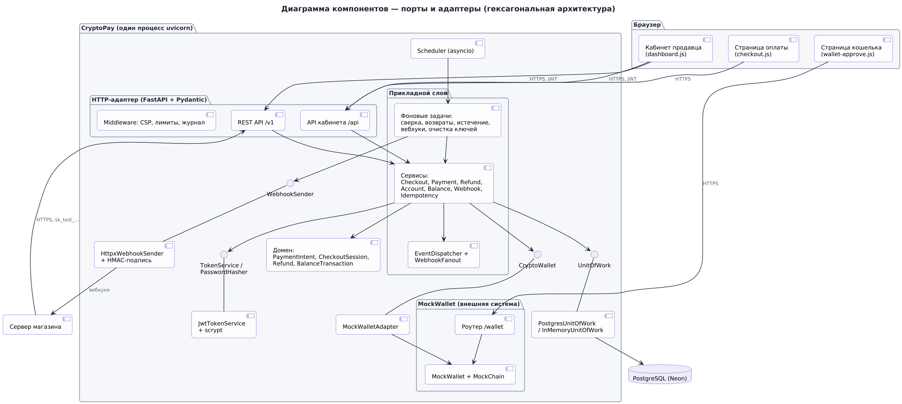

## 3. Объекты как у Stripe

Мы не изобретали свою модель платежей, а повторили модель Stripe — она проверена миллионами интеграций, и её легко объяснить, показав документацию Stripe рядом.

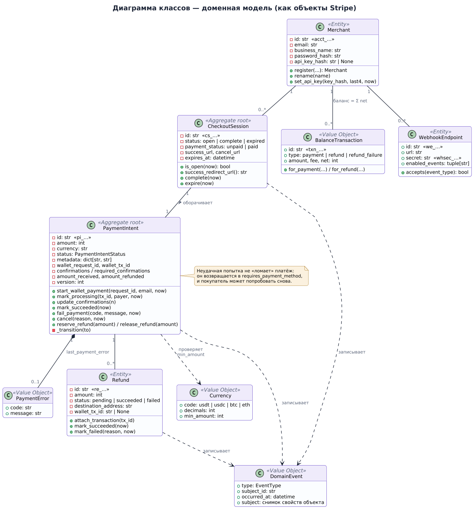

| Объект | Префикс id | Что это | Аналог в Stripe |
|---|---|---|---|
| `Merchant` | `acct_` | Продавец: e-mail, название, хэш пароля, хэш секретного ключа | Account |
| `PaymentIntent` | `pi_` | Намерение получить деньги: сумма, валюта, статус, попытки оплаты | PaymentIntent |
| `CheckoutSession` | `cs_` | Страница оплаты с адресом, сроком жизни и адресами возврата | Checkout Session |
| `Refund` | `re_` | Возврат денег покупателю, полный или частичный | Refund |
| `BalanceTransaction` | `txn_` | Проводка в журнале баланса: сумма, комиссия, чистыми | Balance Transaction |
| `Event` | `evt_` | Запись журнала событий со снимком объекта | Event |
| `WebhookEndpoint` | `we_` | Адрес продавца для вебхуков с секретом `whsec_…` | Webhook Endpoint |

Деньги везде — **целые числа в минимальных единицах**: 25 USDT = `25000000` (6 знаков), 1 BTC = 10⁸ сатоши, 1 ETH = 10¹⁸ wei. Ровно как Stripe принимает 10.00 USD как `amount=1000`. Никаких `float`: у них 15 значащих цифр и `0.1 + 0.2 != 0.3`. В PostgreSQL суммы лежат в `numeric(78,0)` — туда помещается любое 256-битное число.

| Валюта | Знаков | Минимальный платёж |
|---|---|---|
| USDT | 6 | 0.50 USDT |
| USDC | 6 | 0.50 USDC |
| BTC | 8 | 0.00001 BTC |
| ETH | 18 | 0.0001 ETH |

## 4. Жизненный цикл платежа

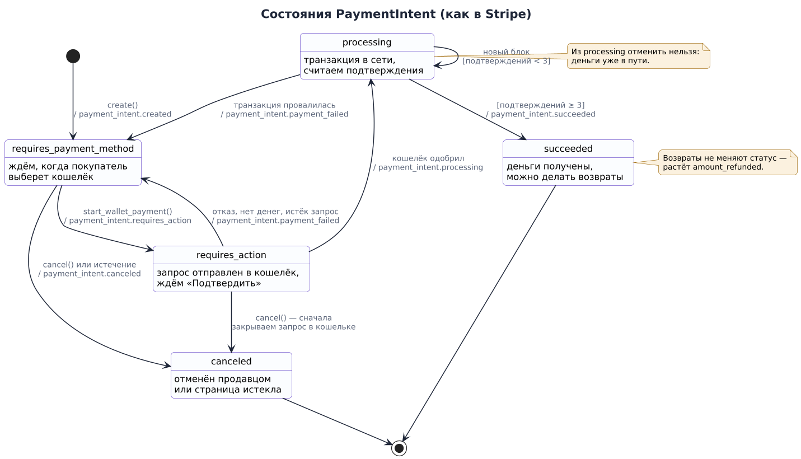

`PaymentIntent` — это конечный автомат. Разрешённые переходы перечислены в словаре `_TRANSITIONS` в `domain/payment_intent.py`, и любой другой переход бросает `InvalidStateError` — с кодом `payment_intent_unexpected_state`, как у Stripe.

| Статус | Что значит | Куда дальше |
|---|---|---|
| `requires_payment_method` | Платёж создан, покупатель ещё не выбрал, чем платить (или прошлая попытка не удалась) | `requires_action`, `canceled` |
| `requires_action` | Покупатель ушёл в кошелёк подтверждать платёж | `processing`, `requires_payment_method`, `canceled` |
| `processing` | Транзакция в сети, копим подтверждения | `succeeded`, `requires_payment_method` |
| `succeeded` | Деньги получены, проводка в журнале, сессия закрыта | — (только возвраты) |
| `canceled` | Продавец отменил или страница истекла | — |

Важная деталь, подсмотренная у Stripe: **неудачная попытка не «ломает» платёж**. Если у Боба не хватило денег, платёж возвращается в `requires_payment_method` с полем `last_payment_error`, и покупатель может нажать «Попробовать снова» и заплатить с кошелька Алисы. Отдельного статуса `failed` у PaymentIntent нет.

## 5. Основные сценарии

### 5.1. Создание страницы оплаты

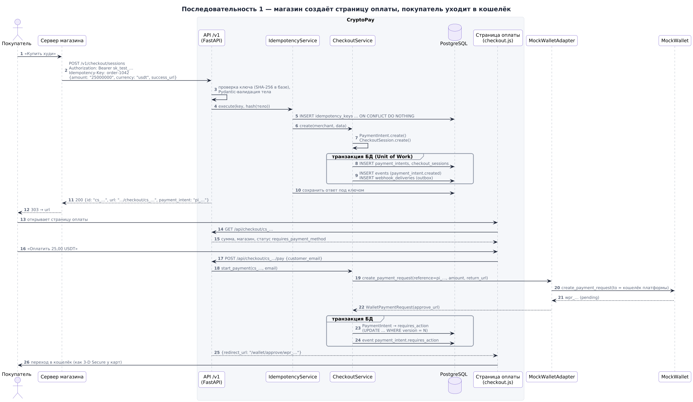

1. Сервер магазина отправляет `POST /v1/checkout/sessions` с секретным ключом и заголовком `Idempotency-Key`.
2. `IdempotencyService` атомарно «занимает» ключ (`INSERT … ON CONFLICT DO NOTHING`). Если этот ключ уже обрабатывался — возвращает сохранённый ответ с заголовком `Idempotent-Replayed: true`.
3. `CheckoutService.create` в одной транзакции создаёт `PaymentIntent` и `CheckoutSession`, записывает события и ставит вебхуки в очередь.
4. Магазин получает `url` страницы и перенаправляет туда покупателя.
5. Покупатель жмёт «Оплатить» → `CheckoutService.start_payment` просит кошелёк создать запрос на оплату и переводит платёж в `requires_action`.
6. Страница оплаты отправляет покупателя в окно кошелька — так же, как карта отправляет на 3-D Secure.

### 5.2. Подтверждение и сверка

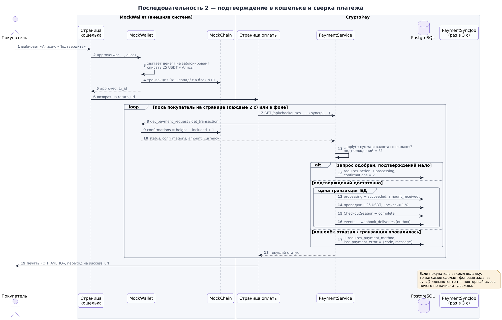

Главный алгоритм системы — `PaymentService.sync()`. Он вызывается двумя путями: страница оплаты дёргает его при каждом опросе (чтобы покупатель видел прогресс сразу), а фоновая задача `PaymentSyncJob` — раз в `WORKER_INTERVAL_MS` для всех незавершённых платежей (на случай, если покупатель закрыл вкладку).

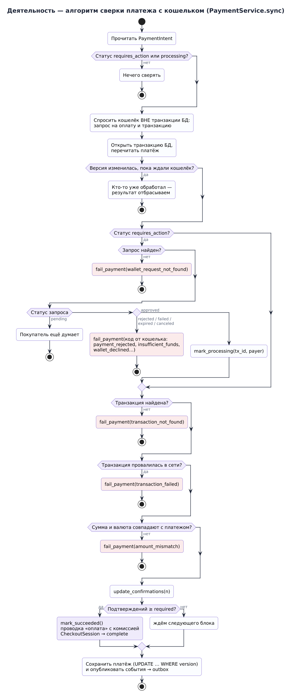

Как он устроен и почему:

1. **Наблюдение вне транзакции.** Сначала мы спрашиваем кошелёк о запросе и транзакции. Это сетевой вызов, и держать во время него открытую транзакцию БД — плохая идея: соединения из пула быстро закончатся.
2. **Перечитать и сравнить версию.** Открываем транзакцию, заново читаем платёж и сравниваем `version`. Если он изменился, пока мы ждали кошелёк (например, параллельно сработали страница и фоновая задача), — этот проход просто отбрасывается. Это оптимистическая блокировка.
3. **Не доверять кошельку.** Сумма и валюта транзакции сверяются с платежом. Не совпало — `amount_mismatch`, платёж не засчитан.
4. **Подтверждения.** Платёж успешен, только когда транзакция `confirmed` и подтверждений не меньше `REQUIRED_CONFIRMATIONS` (по умолчанию 3).
5. **Атомарно.** Статус `succeeded`, проводка в журнале баланса (с комиссией платформы), закрытие сессии, события и очередь вебхуков записываются в **одной** транзакции. Либо всё, либо ничего.

Защита от двойного зачисления стоит и на уровне базы: `wallet_tx_id` уникален в `payment_intents`, а частичный уникальный индекс разрешает только одну проводку типа `payment` на один платёж.

### 5.3. Вебхуки: Transactional Outbox

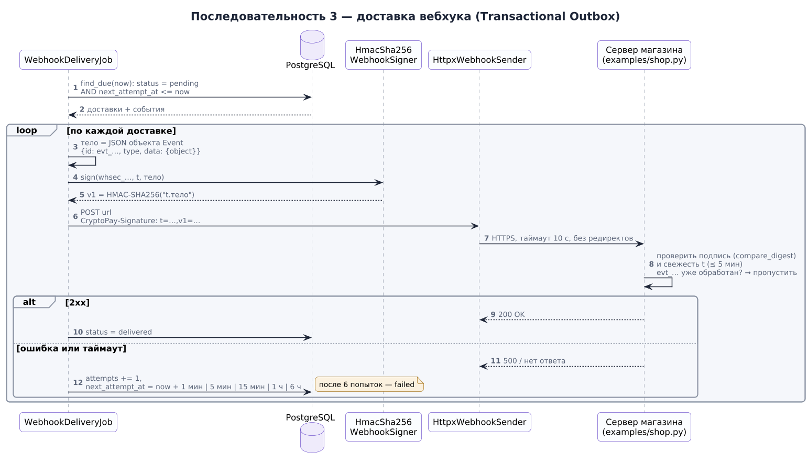

Нельзя отправлять HTTP-запрос продавцу прямо из транзакции: если транзакция откатится, вебхук уже ушёл, а если упадёт отправка — откатывать оплату глупо. Поэтому используется паттерн **Transactional Outbox**:

1. Сервис публикует доменные события через `EventPublisher`.
2. `EventDispatcher` (паттерн Observer) превращает каждое событие в запись `Event` в формате Stripe и раздаёт подписчикам.
3. Подписчик `WebhookFanout` для каждого подходящего адреса продавца кладёт строку в `webhook_deliveries` — **в той же транзакции**, что и изменение платежа.
4. Фоновая задача `WebhookDeliveryJob` забирает созревшие доставки, подписывает тело HMAC-SHA256 и отправляет.
5. Не получилось — повтор через 1 мин, 5 мин, 15 мин, 1 ч, 6 ч; после 6 попыток доставка помечается `failed`. Это видно в кабинете и через `GET /v1/events/{id}/deliveries`.

Подпись в заголовке `cryptopay-signature: t=<unix>,v1=<hex>` — та же схема, что `Stripe-Signature`. Магазин проверяет её и отбрасывает запросы старше 5 минут (защита от повторного воспроизведения). Готовая проверка — функция `verify_signature()` в `examples/shop.py`.

### 5.4. Возврат

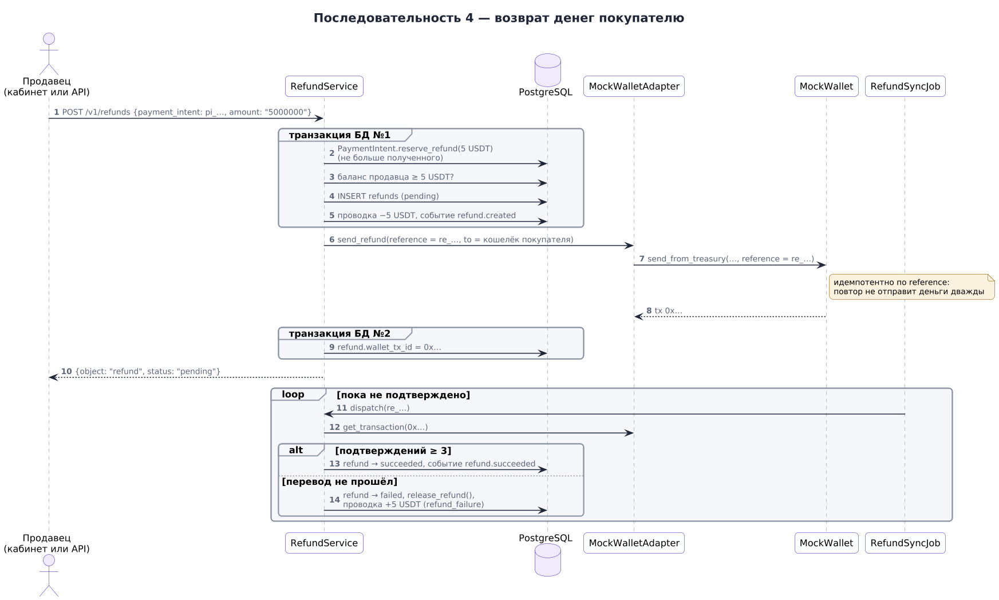

Возврат — двухфазный, потому что в нём участвуют две системы, у которых нет общей транзакции:

1. **В нашей базе** (одна транзакция): проверяем, что платёж `succeeded` и сумма не больше возвращаемого остатка, резервируем сумму (`amount_refunded`), проверяем баланс продавца, создаём `Refund` в статусе `pending`, пишем отрицательную проводку `refund`.
2. **В кошельке**: `send_refund()` с `reference = re_…`. Отправка идемпотентна по reference: если сервер упадёт между шагами и `RefundSyncJob` повторит отправку, кошелёк вернёт уже существующую транзакцию, а не отправит деньги второй раз.
3. **Подтверждение**: когда транзакция возврата набрала подтверждения, `Refund` становится `succeeded`. Если она провалилась — `failed`, резерв снимается, и в журнал пишется компенсирующая проводка `refund_failure`, возвращающая деньги на баланс.

Комиссия платформы при возврате не возвращается — так же делает Stripe.

### 5.5. Идемпотентность

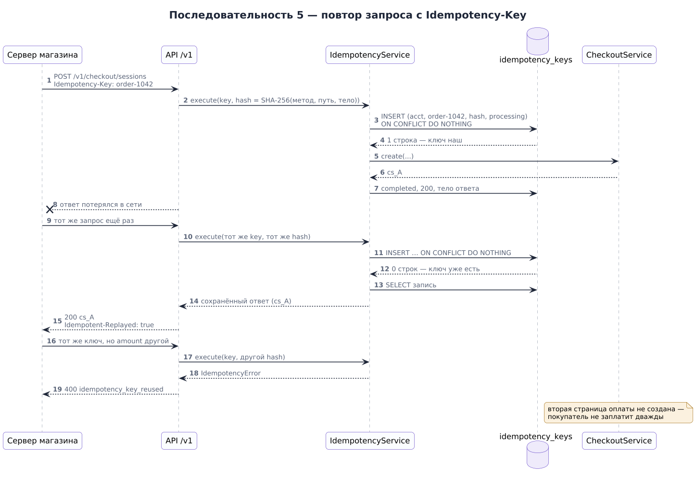

Сеть ненадёжна: магазин отправил запрос, а ответ потерялся. Повторить запрос страшно — вдруг создастся вторая страница оплаты? Поэтому все `POST` в `/v1` принимают заголовок `Idempotency-Key`:

- первый запрос с ключом выполняется, ответ сохраняется на 24 часа;
- повтор с тем же ключом и тем же телом возвращает **тот же** ответ с заголовком `Idempotent-Replayed: true`;
- повтор с тем же ключом, но **другим** телом — ошибка `idempotency_key_reused`: скорее всего, это баг у магазина;
- пока первый запрос ещё выполняется, параллельный повтор получает `idempotency_key_in_use` и не дублирует работу.

## 6. Хранение

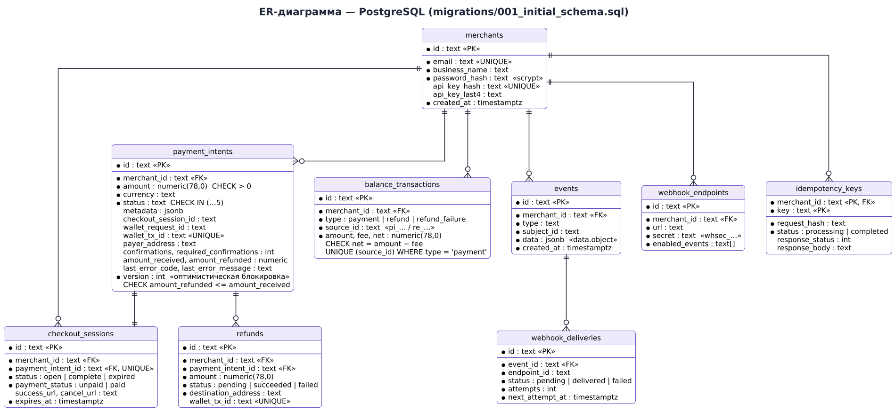

Девять таблиц в `migrations/001_initial_schema.sql`. Миграции применяются автоматически при старте. Что стоит отметить:

- **CHECK-ограничения** дублируют доменные правила: сумма больше нуля, статус из списка, `amount_refunded <= amount_received`, `net = amount − fee`. Даже если в коде появится ошибка, база не примет невозможное состояние.
- **Оптимистическая блокировка**: `UPDATE … WHERE id = $1 AND version = $2`. Если строк обновлено ноль — кто-то успел раньше, бросается `ConcurrencyError`.
- **Индексы под курсорную пагинацию**: списки отдаются по `(created_at DESC, id DESC)` с параметром `starting_after`, как в Stripe. В отличие от `OFFSET`, такая пагинация не «прыгает», когда в начало списка добавляются новые записи.

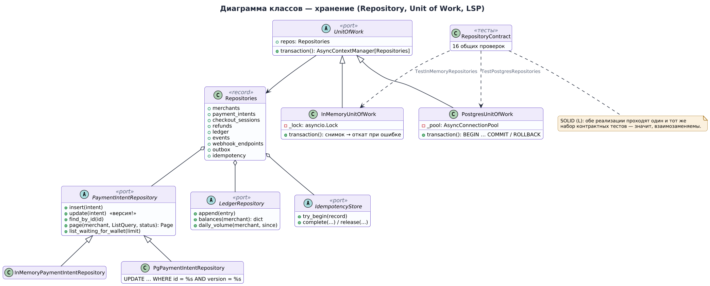

Репозитории описаны в `application/ports/repositories.py` как ABC, а реализованы дважды: в памяти (`infrastructure/memory`) и в PostgreSQL (`infrastructure/postgres`). Обе реализации проходят **один и тот же** набор контрактных тестов — это принцип подстановки Лисков, проверенный автоматически.

`UnitOfWork.transaction()` — асинхронный контекстный менеджер. Внутри него все репозитории работают в одной транзакции; при исключении всё откатывается.

## 7. Фоновые задачи

`infrastructure/scheduler.py` раз в `WORKER_INTERVAL_MS` (3 секунды) по очереди запускает задачи. Каждая — класс с одним методом `run()` и отчётом `JobReport`:

| Задача | Что делает |
|---|---|
| `PaymentSyncJob` | Сверяет все платежи в `requires_action` и `processing` с кошельком |
| `RefundSyncJob` | Отправляет зависшие возвраты и отслеживает их подтверждения |
| `SessionExpiryJob` | Закрывает просроченные страницы оплаты и отменяет их платежи |
| `WebhookDeliveryJob` | Доставляет вебхуки из outbox с повторами |
| `IdempotencyCleanupJob` | Удаляет ключи идемпотентности старше 24 часов |

Ошибка в одной задаче не останавливает остальные: она попадает в отчёт и в лог. Все задачи идемпотентны — их можно запускать сколько угодно раз и параллельно со страницей оплаты.

## 8. Интерфейс

Фронтенд — статические страницы в `public/` без сборщика: HTML, CSS и нативные ES-модули. Так нет `node_modules`, нет шага сборки и ничего не ломается при деплое.

| Страница | Кто видит | Что там |
|---|---|---|
| `/` | Все | Описание, пример кода, кнопка «Попробовать оплату» |
| `/checkout/cs_…` | Покупатель | Сумма, e-mail, кнопка оплаты, прогресс подтверждений, печать «Оплачено» |
| `/wallet/approve/wpr_…` | Покупатель | Окно кошелька: выбор тестового кошелька, «Подтвердить» / «Отклонить» |
| `/wallet` | Все | Обозреватель MockChain: блоки, балансы, транзакции |
| `/dashboard` | Продавец | Баланс, оборот за неделю, платежи, возвраты, журнал, события, ключи и вебхуки |
| `/docs` | Разработчики | Swagger UI со всеми методами API |

Строгий CSP (`script-src 'self'`) запрещает встроенные скрипты, поэтому весь JavaScript лежит в отдельных файлах, а обработчики навешиваются через `addEventListener`. Сквозные тесты следят, чтобы в консоли браузера не было ни одной ошибки CSP.

## 9. Принятые решения и их цена

| Решение | Почему | Чем заплатили |
|---|---|---|
| Модель объектов Stripe | Проверенная модель, понятная по документации; легко объяснить на защите | Больше объектов, чем в «простом счёте» |
| Имитация кошелька вместо блокчейна | Демонстрация не зависит от сети, все сценарии воспроизводимы | Нужно объяснять, что интеграция «настоящая» на уровне архитектуры |
| Один процесс | Бесплатный хостинг, простое развёртывание | Нельзя масштабировать горизонтально без выноса кошелька и планировщика |
| Опрос кошелька вместо push-уведомлений | Работает и после перезапуска, не теряет событий | Задержка до одного интервала фоновой задачи |
| Transactional Outbox | Вебхук не уходит без оплаты и не теряется при сбое | Отдельная таблица и фоновая задача |
| Оптимистическая блокировка | Нет долгих блокировок строк, параллельные проходы безопасны | Иногда работа выполняется зря и отбрасывается |
| Два хранилища (память и PostgreSQL) | Тесты и демо без базы; LSP проверен контрактными тестами | Две реализации каждого репозитория |
