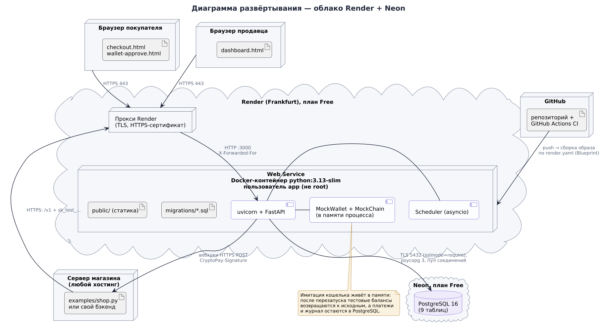

# Развёртывание CryptoPay

Третий пункт задания — «проект запущен на любом облачном сервере». Рекомендуемый путь — **Render (сервер) + Neon (PostgreSQL)**: оба бесплатны, не требуют банковской карты, и HTTPS-адрес появляется сам. Весь путь занимает 10–15 минут. Ниже также описаны VPS с Docker и локальный запуск.

Хорошая новость по сравнению с версией на настоящем блокчейне: **больше ничего не нужно**. Ни MetaMask, ни тестовых монет с «кранов», ни RPC-ключей — кошелёк и сеть имитируются внутри приложения.



## Вариант 1. Render + Neon (бесплатно)

### Шаг 1. Залить код на GitHub

1. Зарегистрируйтесь на [github.com](https://github.com) и создайте пустой репозиторий `cryptopay` (без README).
2. В папке проекта:

```bash
git init
git add .
git commit -m "CryptoPay: платёжная система в стиле Stripe"
git branch -M main
git remote add origin https://github.com/<ваш-логин>/cryptopay.git
git push -u origin main
```

`.venv`, кэши и `.env` в репозиторий не попадут — они перечислены в `.gitignore`.

### Шаг 2. База данных в Neon

1. Зайдите на [neon.com](https://neon.com) → Sign up через GitHub.
2. **Create project**: имя `cryptopay`, PostgreSQL 16 или новее, регион **AWS Europe Central (Frankfurt)** — рядом с сервером Render.
3. На странице проекта нажмите **Connect** и скопируйте строку подключения вида
   `postgresql://neondb_owner:…@ep-…-pooler.eu-central-1.aws.neon.tech/neondb?sslmode=require&channel_binding=require`.

Таблицы создавать не нужно: приложение само применит миграции при первом запуске. Бесплатная база Neon засыпает после 5 минут без запросов — первый запрос после паузы чуть медленнее, данные не теряются.

### Шаг 3. Сервер в Render

1. Зайдите на [render.com](https://render.com) → Sign up через GitHub.
2. **New → Blueprint** → выберите репозиторий `cryptopay`. Render найдёт `render.yaml` и покажет сервис `cryptopay` (Docker, план Free, регион Frankfurt).
3. Render попросит значение `DATABASE_URL` — вставьте строку из Neon. `JWT_SECRET` он сгенерирует сам.
4. Нажмите **Apply** (Deploy Blueprint). Первая сборка Docker-образа идёт 3–6 минут.
5. Когда статус станет **Live**, откройте адрес вида `https://cryptopay-xxxx.onrender.com`.

**Проверка.** Откройте `https://cryptopay-xxxx.onrender.com/healthz`:

```json
{"status": "ok", "version": "2.0.0", "storage": "postgres", "database": "ok",
 "wallet": {"type": "mock", "height": 1204}}
```

`storage: postgres` — значит, данные пишутся в Neon; `wallet.height` — текущая высота имитируемой сети, она растёт на 1 каждые 3 секунды. Swagger UI — на `/docs`.

Особенности бесплатного плана Render: сервис засыпает после 15 минут без запросов и просыпается примерно за минуту при первом обращении. **Перед защитой откройте сайт заранее.** Во время сна фоновые задачи останавливаются и догоняют работу после пробуждения; имитатор кошелька при пробуждении начинает сеть заново (его состояние живёт в памяти), но платежи и журнал в PostgreSQL остаются.

> Если Render не предлагает план Free для Docker-сервиса, поменяйте в `render.yaml` строку `runtime: docker` на `runtime: python` и добавьте `buildCommand: pip install -r requirements.txt` и `startCommand: python -m cryptopay`.

Без шага 2 тоже работает: если оставить `DATABASE_URL` пустым, приложение запустится с хранением в памяти — в кабинете продавца появится плашка об этом, а данные пропадут при перезапуске. Можно создать базу и в самом Render, но бесплатная база там удаляется через 30 дней, так что для сдачи проекта надёжнее Neon.

### Шаг 4. Проверить, что всё работает

1. На главной нажмите **«Попробовать оплату»** → откроется страница оплаты на 25 USDT от демо-магазина.
2. **«Оплатить»** → окно MockWallet → выберите **Алису** → **«Подтвердить»**.
3. Через ~10–15 секунд на странице появится печать **«Оплачено»**.
4. Откройте `/dashboard` → **«Войти в демо-аккаунт»** (данные указаны на странице входа: `demo@cryptopay.dev` / `demo-password`). Платёж уже в списке, баланс пополнился на 24.75 USDT (25 минус 1 % комиссии).
5. Откройте платёж и сделайте частичный возврат — через несколько блоков он станет «Возвращён».
6. Вебхуки: в разделе **«Разработчикам»** добавьте адрес с [webhook.site](https://webhook.site) и нажмите «Отправить тестовое событие» — запрос с подписью появится на webhook.site.

## Вариант 2. Любой VPS с Docker

Подойдёт DigitalOcean, Hetzner, Yandex Cloud, Azure for Students (кредиты по GitHub Student Pack) и т. п.

```bash
# на сервере (Ubuntu 22.04+)
curl -fsSL https://get.docker.com | sh
git clone https://github.com/<ваш-логин>/cryptopay.git && cd cryptopay
cat > deploy/.env <<EOF
DOMAIN=203-0-113-10.sslip.io
JWT_SECRET=$(openssl rand -hex 32)
POSTGRES_PASSWORD=$(openssl rand -hex 16)
EOF
docker compose -f deploy/docker-compose.prod.yml --env-file deploy/.env up -d --build
```

Поднимутся три контейнера: приложение, PostgreSQL 16 и Caddy. `DOMAIN` — ваш домен или `<IP-через-дефисы>.sslip.io`: сервис sslip.io превращает IP в доменное имя, и Caddy автоматически получит для него сертификат Let's Encrypt. Откройте порты 80 и 443.

## Вариант 3. Локально

Нужен Python 3.12 или новее.

```bash
python -m venv .venv
source .venv/bin/activate          # Windows: .venv\Scripts\activate
pip install -r requirements-dev.txt
pip install -e . --no-deps
```

| Команда | Что получится |
|---|---|
| `python -m cryptopay` | http://localhost:3000, данные в памяти, демо-аккаунт создан |
| `python -m cryptopay --reload` | То же, с перезапуском при правке кода |
| `docker compose up --build` | Приложение + PostgreSQL в контейнерах, как в production |

Пример магазина в соседнем терминале (ключ и секрет вебхука — из кабинета, раздел «Разработчикам»; адрес вебхука — `http://localhost:4000/webhook`):

```bash
CRYPTOPAY_API_KEY=sk_test_… WEBHOOK_SECRET=whsec_… python examples/shop.py
# откройте http://localhost:4000 → «Купить через CryptoPay»
```

## Переменные окружения

| Переменная | По умолчанию | Назначение |
|---|---|---|
| `APP_ENV` | `development` | `production` включает HSTS, JSON-логи, требует `JWT_SECRET` и запрещает `http://` для вебхуков |
| `PORT` | `3000` | Порт HTTP (Render задаёт сам) |
| `PUBLIC_URL` | `RENDER_EXTERNAL_URL` или `http://localhost:PORT` | Адрес сайта: из него строятся ссылки на страницы оплаты |
| `JWT_SECRET` | — | Секрет подписи сессий кабинета, от 32 символов |
| `SESSION_TTL` | `12h` | Сколько живёт сессия продавца |
| `DATABASE_URL` | пусто → память | Строка подключения PostgreSQL |
| `DATABASE_SSL` | `auto` | `auto` / `true` / `false` / `no-verify` |
| `REQUIRED_CONFIRMATIONS` | `3` | Сколько блоков ждать до `succeeded` |
| `PLATFORM_FEE_BPS` | `100` | Комиссия платформы в базисных пунктах (100 = 1 %) |
| `MOCK_BLOCK_TIME_SECONDS` | `3` | Как часто появляется блок в MockChain |
| `DEMO_ACCOUNT` | `true` | Создать демо-продавца и включить кнопку «Попробовать оплату» |
| `DEMO_EMAIL`, `DEMO_PASSWORD` | `demo@cryptopay.dev`, `demo-password` | Данные демо-аккаунта |
| `WORKER_ENABLED` | `true` | Фоновые задачи |
| `WORKER_INTERVAL_MS` | `3000` | Период фоновых задач |
| `TRUST_PROXY` | `1` | Сколько обратных прокси перед приложением (для IP клиента в лимитах) |
| `ALLOW_HTTP_WEBHOOKS` | `true` вне production | Разрешить `http://` и localhost для вебхуков |
| `LOG_LEVEL` | `info` | Подробность логов |

Полный список с комментариями — в `.env.example`. Все значения проверяются Pydantic при старте: опечатка в переменной остановит запуск с понятным сообщением, а не всплывёт через час работы.

## Если что-то пошло не так

| Симптом | Причина и решение |
|---|---|
| Сайт открывается минуту | Render будил уснувший сервис. Перед демонстрацией откройте сайт заранее |
| `/healthz`: `"database": "unavailable"`, статус 503 | Неверная `DATABASE_URL` или база Neon удалена. Проверьте строку подключения в настройках сервиса Render |
| В кабинете плашка «данные хранятся в памяти» | `DATABASE_URL` не задана — это демо-режим. Добавьте строку из Neon |
| Ссылка на страницу оплаты ведёт на `localhost` | На VPS не задан `PUBLIC_URL` (в `docker-compose.prod.yml` он берётся из `DOMAIN`). На Render переменную задавать не нужно |
| Сборка на Render падает на `pip install` | Проверьте, что `requirements.txt` в репозитории и выбран Docker-runtime |
| Ошибка SSL к базе | Для Neon оставьте `DATABASE_SSL=auto`; для баз с самоподписанным сертификатом — `no-verify` |
| После перезапуска «Сессия закончилась» | Нормально, если `JWT_SECRET` не задан; на Render он задаётся через `render.yaml` |
| Тестовые балансы кошельков «обнулились» | Сервер перезапускался — имитатор живёт в памяти. Кнопка «Сбросить тестовые балансы» в `/wallet` вернёт начальные значения в любой момент |
| `ModuleNotFoundError: cryptopay` локально | Активируйте `.venv` и выполните `pip install -e . --no-deps` в корне проекта |
