# UML-диаграммы CryptoPay

Задание требует «диаграммы — всё, что мы прошли». Ниже 24 диаграммы: все виды UML 2.5 из курса (структурные и поведенческие), плюс ER-модель базы, модель C4 и календарный план. Каждая нарисована по **настоящему коду** — имена классов, методов, таблиц и статусов совпадают с репозиторием, поэтому любую стрелку можно показать в коде.

Исходники — в `docs/diagrams/*.puml` (PlantUML, общий стиль в `_style.iuml`), готовые картинки — в `docs/diagrams/png` и `docs/diagrams/svg`.

## Как читать этот набор

Если на защите есть пять минут, идите в таком порядке — от общего к частному:

1. **Use case** (01) — кто пользуется системой и зачем.
2. **C4 контекст** (19) — с какими внешними системами она общается.
3. **Компоненты** (15) — из каких частей состоит и где границы.
4. **Классы домена** (02) и **состояния PaymentIntent** (13) — сердце модели.
5. **Последовательности 1 и 2** (06, 07) — как проходит одна оплата.
6. **Классы интеграции с кошельком** (04) — где порт и адаптер, то есть где SOLID.

## Сводная таблица

| № | Диаграмма | Вид UML | Что показывает |
|---|---|---|---|
| 01 | Варианты использования | поведенческая | Акторы и их сценарии |
| 02 | Классы: домен | структурная | Сущности как у Stripe и их связи |
| 03 | Классы: прикладной слой | структурная | Сервисы, порты, принципы SOLID |
| 04 | Классы: интеграция с кошельком | структурная | Порт `CryptoWallet`, адаптер, MockWallet |
| 05 | Классы: хранение | структурная | Repository, Unit of Work, две реализации |
| 06 | Последовательность 1 | поведенческая (взаимодействие) | Создание страницы оплаты и переход в кошелёк |
| 07 | Последовательность 2 | поведенческая (взаимодействие) | Подтверждение и сверка платежа |
| 08 | Последовательность 3 | поведенческая (взаимодействие) | Доставка вебхука через outbox |
| 09 | Последовательность 4 | поведенческая (взаимодействие) | Возврат в две фазы |
| 10 | Последовательность 5 | поведенческая (взаимодействие) | Повтор запроса с `Idempotency-Key` |
| 11 | Деятельность: сверка | поведенческая | Алгоритм `PaymentService.sync()` |
| 12 | Деятельность с дорожками | поведенческая | Процесс оплаты по участникам |
| 13 | Состояния PaymentIntent | поведенческая | Конечный автомат платежа |
| 14 | Состояния сессии, возврата, доставки | поведенческая | Три маленьких автомата |
| 15 | Компоненты | структурная | Порты и адаптеры |
| 16 | Развёртывание | структурная | Render + Neon, браузеры, магазин |
| 17 | Пакеты | структурная | Слои и правило зависимостей |
| 18 | ER-модель | (модель данных) | 9 таблиц PostgreSQL |
| 19 | C4: контекст | (C4) | Система и её окружение |
| 20 | C4: контейнеры | (C4) | Что внутри процесса |
| 21 | Объекты | структурная | Снимок объектов после оплаты и возврата |
| 22 | Временная | поведенческая (взаимодействие) | Статусы во времени, по блокам |
| 23 | Коммуникации | поведенческая (взаимодействие) | Та же оплата, но через связи объектов |
| 24 | Диаграмма Ганта | (управление проектом) | Календарный план работ |

---

## 01. Варианты использования

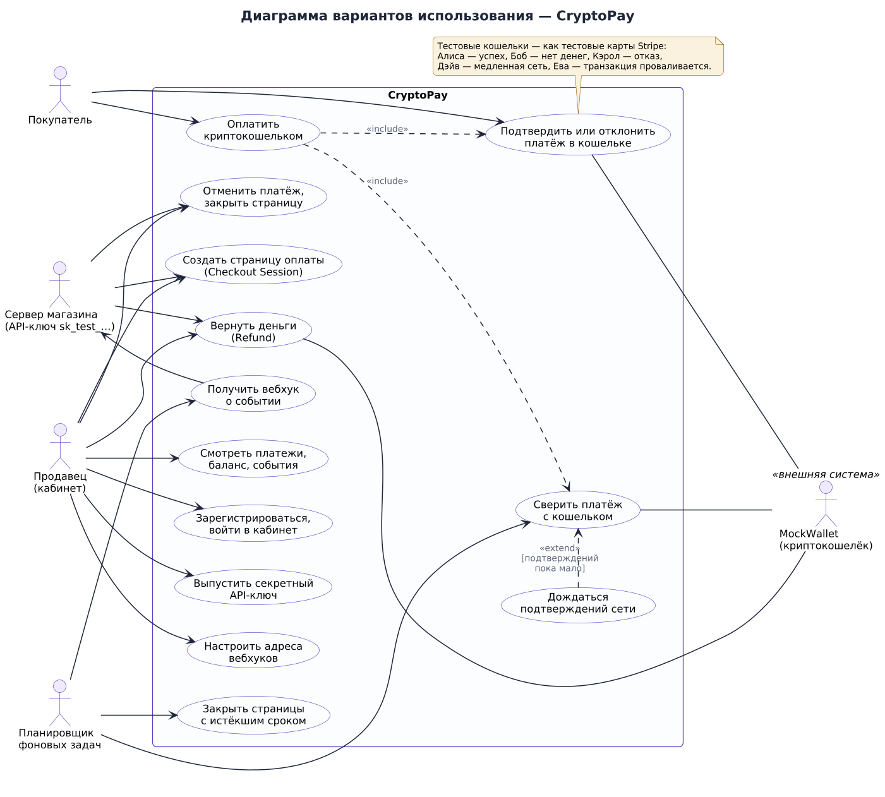

Пять акторов: **покупатель**, **продавец** (через кабинет), **сервер магазина** (через API-ключ), **MockWallet** как внешняя система и **планировщик фоновых задач**. Видно, что продавец и сервер магазина делают во многом одно и то же — создают страницы оплаты, отменяют платежи, делают возвраты, — просто разными путями. Связи `<<include>>` показывают обязательные части сценария: «Оплатить» всегда включает «Подтвердить в кошельке» и «Сверить платёж». `<<extend>>` — условное расширение: «Дождаться подтверждений сети» добавляется к сверке, пока подтверждений мало.

## 02. Классы: доменная модель

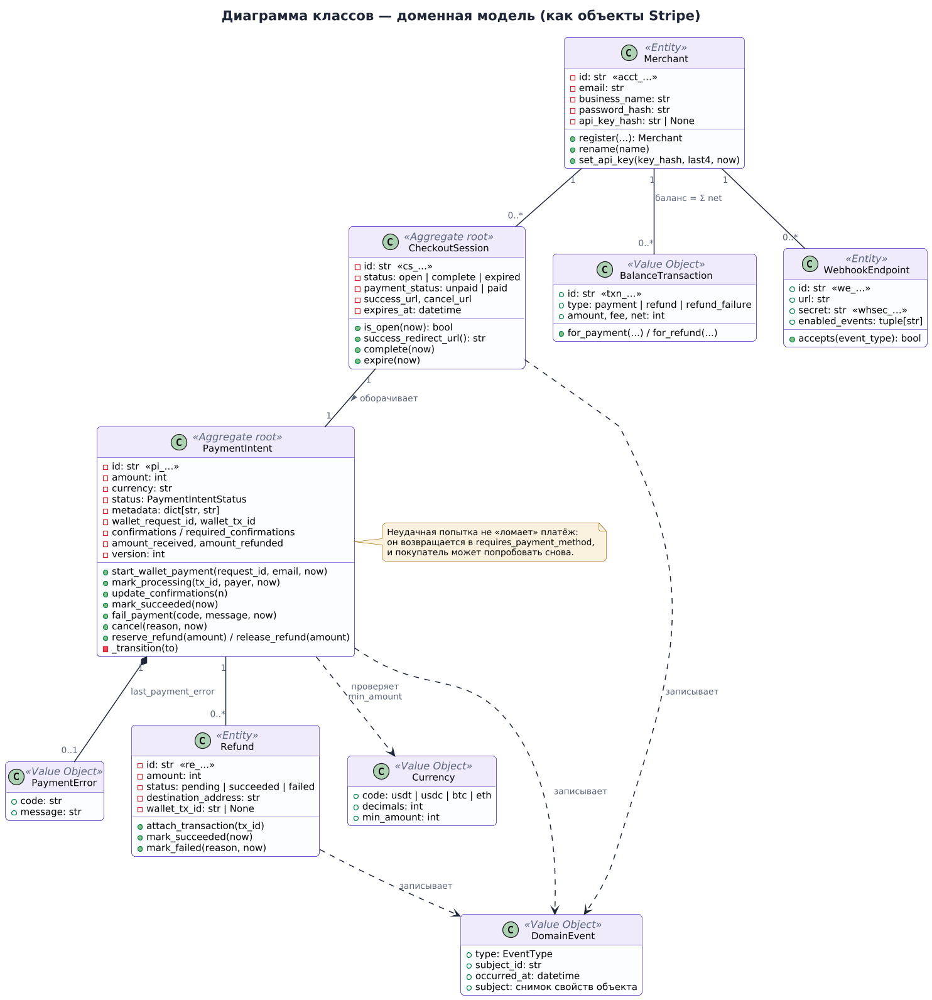

Главная структурная диаграмма. Два корня агрегатов — `PaymentIntent` и `CheckoutSession` (сессия «оборачивает» платёж 1:1), а также `Refund`, `BalanceTransaction`, `WebhookEndpoint` и `Merchant`. Ромб композиции у `PaymentError` означает, что ошибка последней попытки не живёт отдельно от платежа. Пунктирные стрелки «записывает» к `DomainEvent` — сущности не публикуют события сами, а только накапливают их; публикует сервис после сохранения.

## 03. Классы: прикладной слой

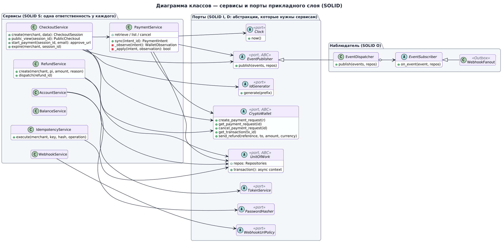

Сервисы и порты, разложенные по пакетам с подписями принципов: «Сервисы (S)», «Порты (I, D)», «Наблюдатель (O)». Обратите внимание: все стрелки от сервисов идут к **абстрактным классам** со стереотипом `<<port>>`, а не к классам инфраструктуры. Это и есть инверсия зависимостей на картинке.

## 04. Классы: интеграция с криптокошельком

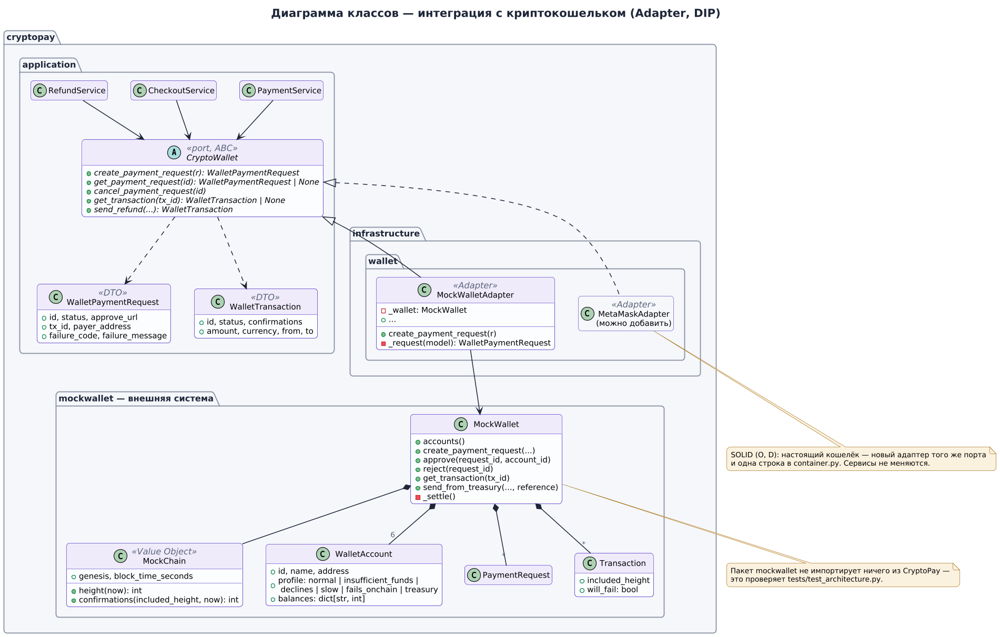

Отвечает на четвёртый пункт задания. Слева — прикладной слой с портом `CryptoWallet`, справа — внешняя система MockWallet со своими моделями (`PaymentRequest`, `Transaction`, `MockChain`). Между ними — единственный класс, который знает обе стороны: `MockWalletAdapter`. На диаграмме отмечено, что замена имитации настоящим кошельком — это новый адаптер, а не изменение сервисов.

## 05. Классы: хранение

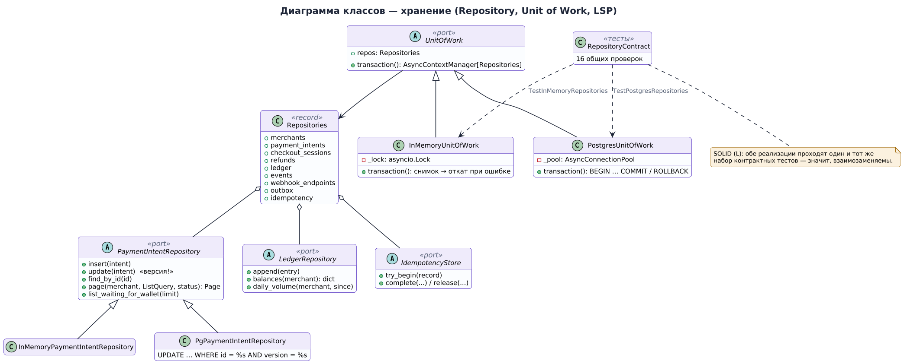

Интерфейсы репозиториев и `UnitOfWork`, и под ними — две реализации: в памяти и в PostgreSQL. Подпись про LSP: обе реализации проверены одним набором контрактных тестов.

## 06. Последовательность 1 — создание страницы оплаты

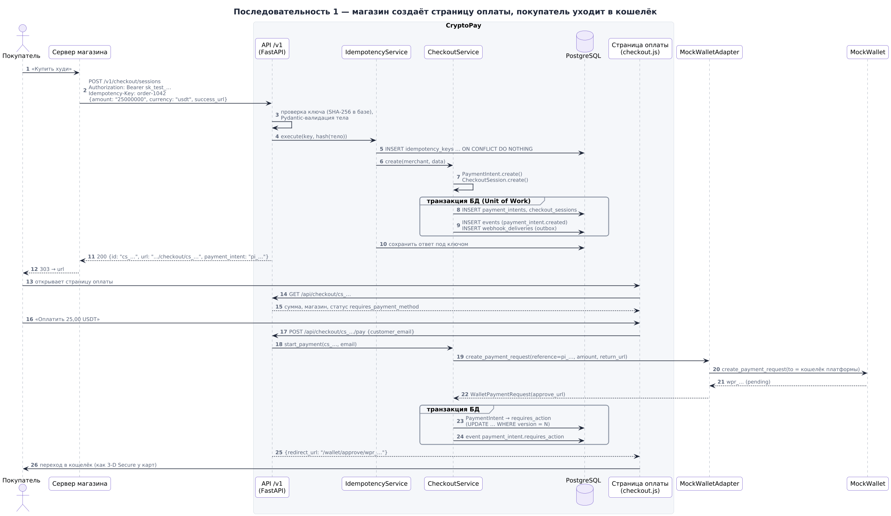

От «Купить худи» в магазине до перехода покупателя в окно кошелька. Видны две транзакции БД (рамки `group`): создание сессии и перевод платежа в `requires_action`. Шаги 4–5 и 10 — идемпотентность. Шаги 19–22 — вызов кошелька через адаптер; он сделан **между** транзакциями, а не внутри.

## 07. Последовательность 2 — подтверждение и сверка

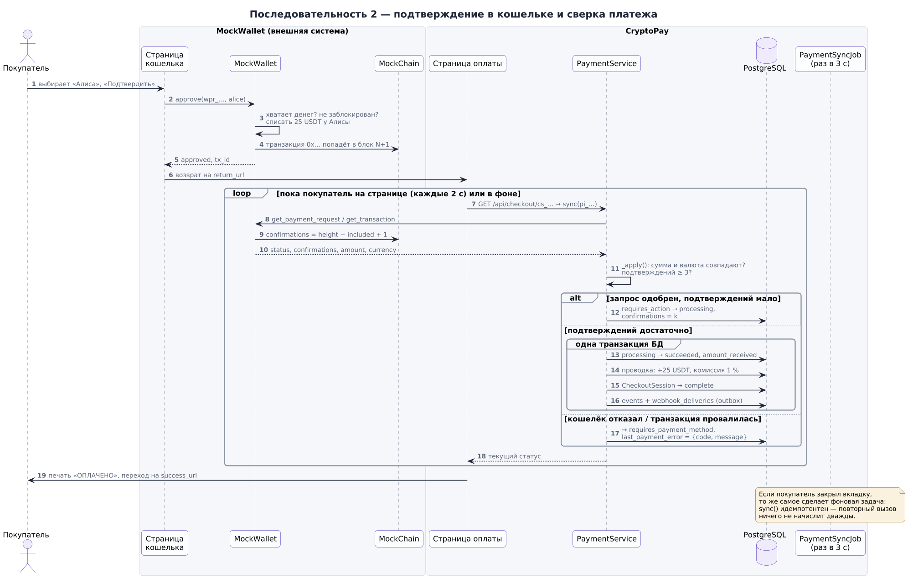

Покупатель подтверждает платёж в кошельке, MockWallet «отправляет» транзакцию, и дальше `PaymentService.sync()` вызывается в цикле (`loop`) — то со страницы оплаты, то из фоновой задачи — пока не наберётся 3 подтверждения. Фрагмент `alt` показывает ветки: транзакция ещё в мемпуле / подтверждений мало / достаточно. Последний шаг — атомарная запись `succeeded` + проводка + закрытие сессии + события.

## 08. Последовательность 3 — доставка вебхука

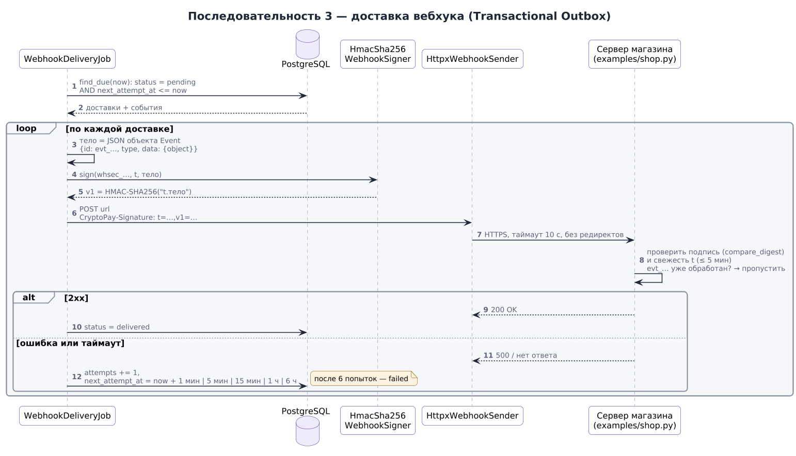

Паттерн Transactional Outbox: событие и строка в `webhook_deliveries` пишутся в одной транзакции с оплатой, а HTTP-запрос отправляет фоновая задача. Фрагмент `alt` показывает успешную доставку и повтор с нарастающей задержкой. Справа — проверка подписи на стороне магазина.

## 09. Последовательность 4 — возврат

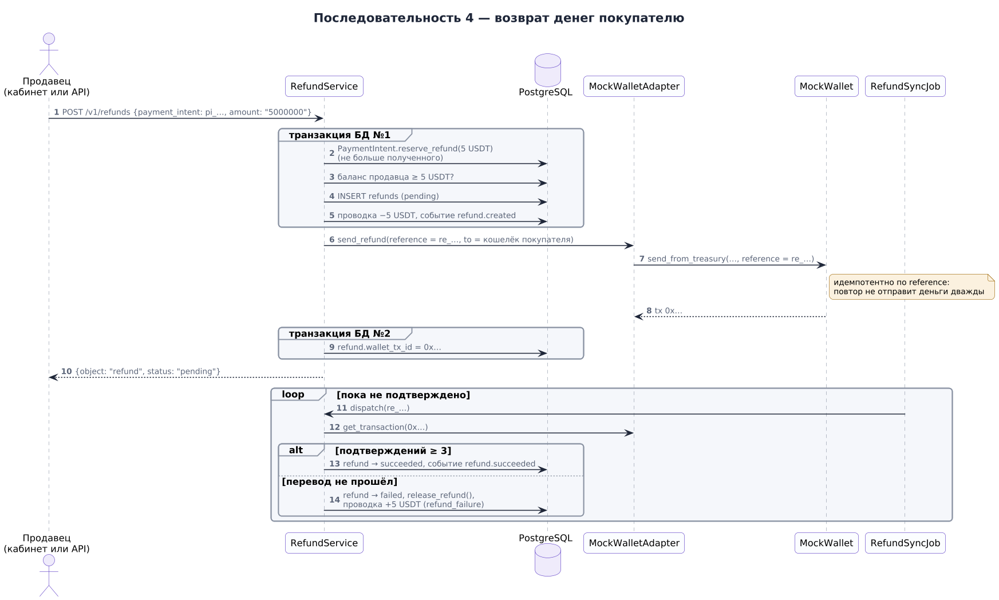

Две транзакции БД и вызов кошелька между ними: сначала резерв суммы и проводка в нашей базе, потом отправка из кошелька платформы с `reference = re_…`, потом запись транзакции возврата. Заметка у кошелька подчёркивает главное: отправка идемпотентна по `reference`, поэтому если сервер упадёт между фазами и `RefundSyncJob` повторит отправку, деньги не уйдут дважды. Цикл `loop` в конце — фоновая задача ждёт подтверждений, ветка `alt` — успех или провал перевода.

## 10. Последовательность 5 — идемпотентность

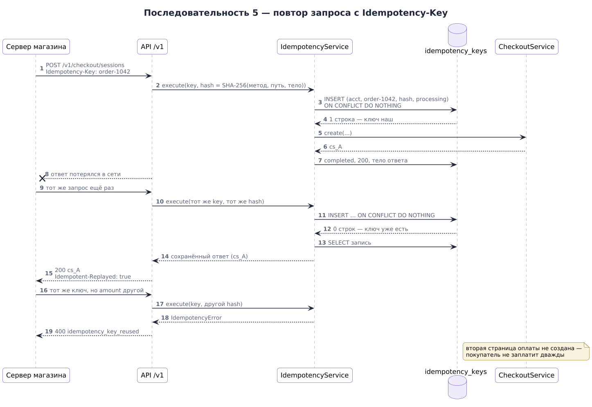

Три запроса подряд с одним `Idempotency-Key`. Первый выполняется, но ответ теряется в сети (крестик на стрелке). Второй — тот же запрос — получает сохранённый ответ с заголовком `Idempotent-Replayed: true`, а вторая сессия не создаётся. Третий — тот же ключ, но другая сумма — получает ошибку `idempotency_key_reused`. Ключевой момент — `INSERT … ON CONFLICT DO NOTHING`: «занять» ключ атомарно, без гонки двух параллельных повторов.

## 11. Деятельность — алгоритм сверки

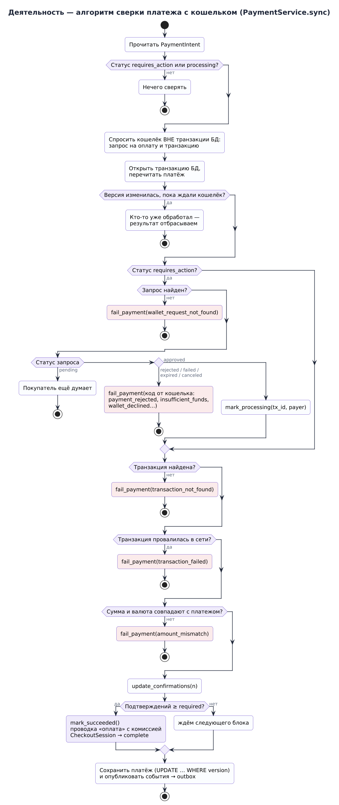

Блок-схема `PaymentService.sync()` с решениями (ромбами): платёж ещё ждёт кошелёк? запрос подтверждён? транзакция найдена? сумма совпадает? подтверждений достаточно? Хорошо видно, что каждая «плохая» ветка ведёт в `fail_payment` с конкретным кодом ошибки, а платёж возвращается в `requires_payment_method`.

## 12. Деятельность с дорожками — процесс оплаты

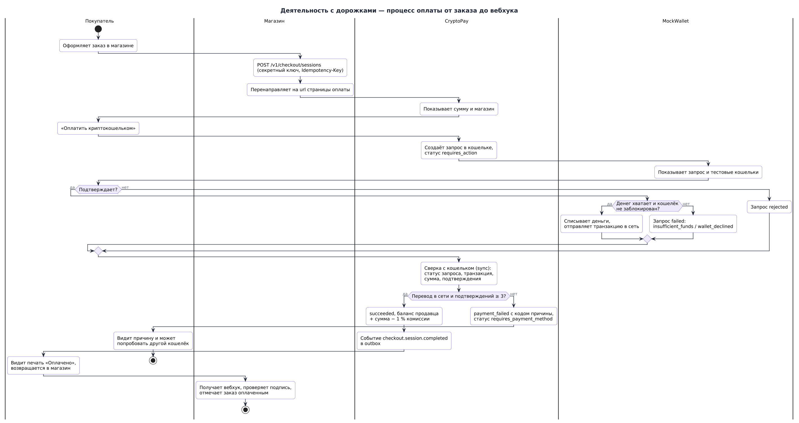

Тот же процесс, разложенный по исполнителям: покупатель, магазин, CryptoPay, кошелёк. Дорожки (swimlanes) помогают увидеть, кто ждёт кого: например, магазин ничего не делает между созданием сессии и вебхуком.

## 13. Состояния PaymentIntent

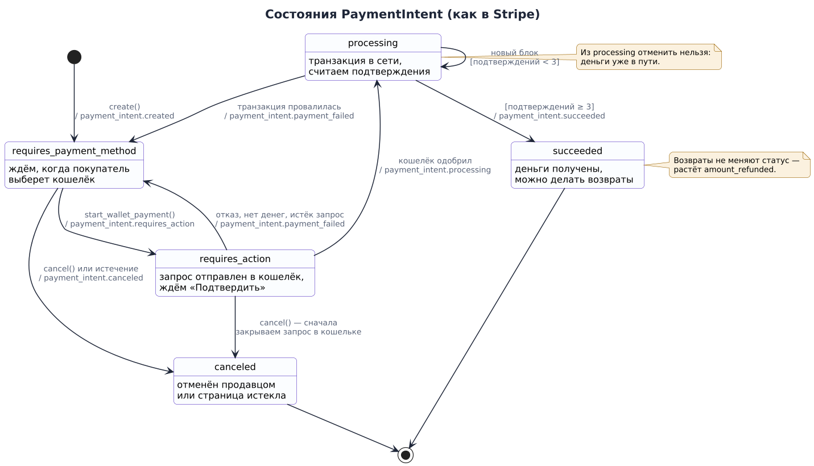

Конечный автомат платежа — точная копия словаря `_TRANSITIONS` из `domain/payment_intent.py`. Ключевая мысль: из `requires_action` и `processing` при неудаче платёж возвращается в `requires_payment_method`, а не в тупиковый `failed`.

## 14. Состояния CheckoutSession, Refund и доставки вебхука

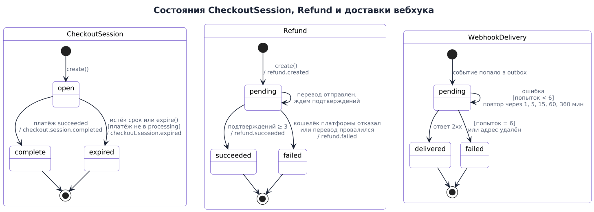

Три маленьких автомата на одной диаграмме. Сессия: `open → complete | expired`. Возврат: `pending → succeeded | failed`. Доставка: `pending → delivered | failed` с петлёй повторов и счётчиком попыток.

## 15. Компоненты

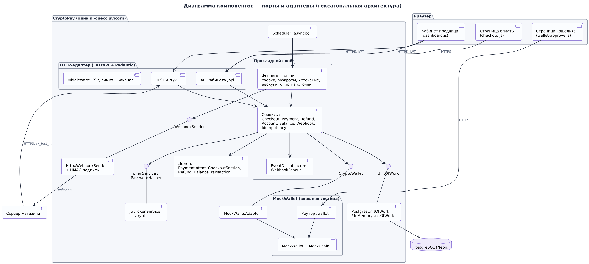

Гексагональная архитектура: в центре прикладной слой и домен, по краям — адаптеры (HTTP, PostgreSQL, httpx, JWT, MockWalletAdapter). Кружки «леденцы» — порты-интерфейсы. MockWallet нарисован отдельным пакетом «внешняя система», с которым CryptoPay связан только через адаптер.

## 16. Развёртывание

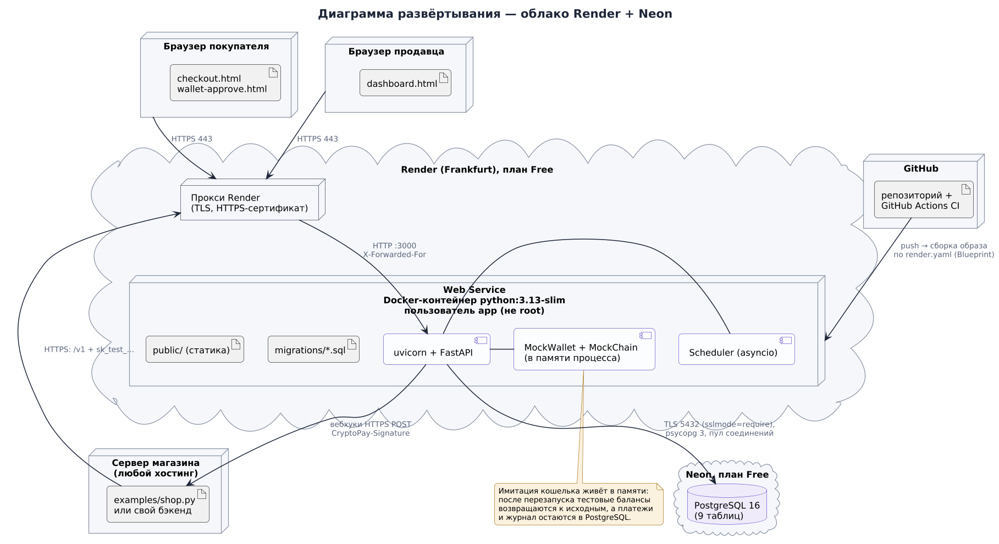

Узлы: браузер покупателя и продавца, сервер магазина, контейнер Docker на Render (Python 3.13, uvicorn, один процесс), база PostgreSQL в Neon. На связях — протоколы (HTTPS, TLS к базе). Альтернативный вариант — VPS с Docker Compose и Caddy — описан в [deployment.md](deployment.md).

## 17. Пакеты

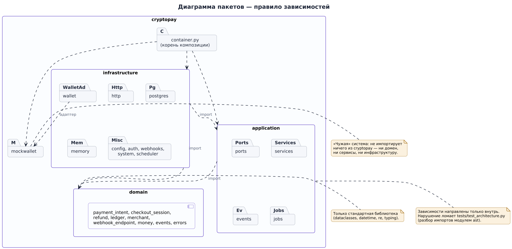

Правило зависимостей: стрелки `<<import>>` идут только внутрь — `infrastructure → application → domain`. `mockwallet` стоит особняком и не импортирует ничего из CryptoPay. Это правило проверяется тестом `tests/test_architecture.py`.

## 18. ER-модель

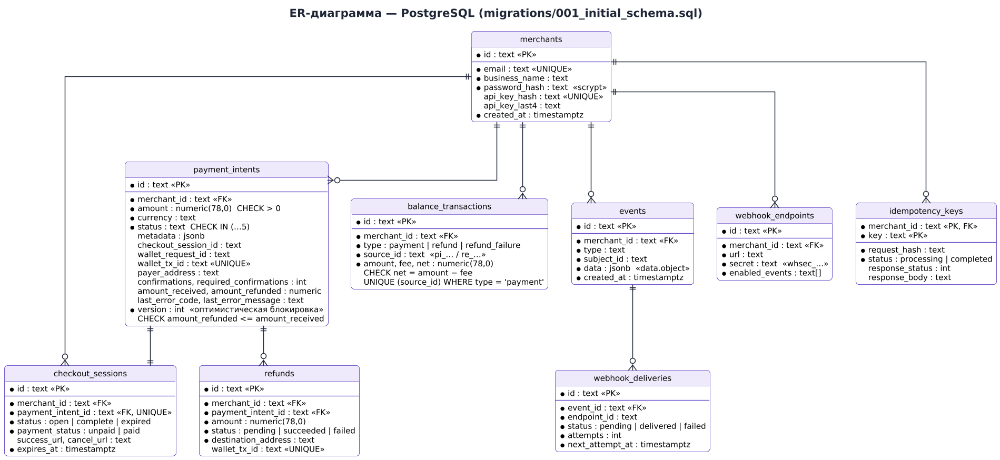

Девять таблиц из `migrations/001_initial_schema.sql` в нотации «вороньих лапок». На полях отмечены ограничения, которые защищают данные даже при ошибке в коде: `CHECK amount > 0`, `UNIQUE wallet_tx_id`, частичный уникальный индекс «одна проводка `payment` на платёж», `CHECK net = amount − fee`.

## 19. C4, уровень 1 — контекст

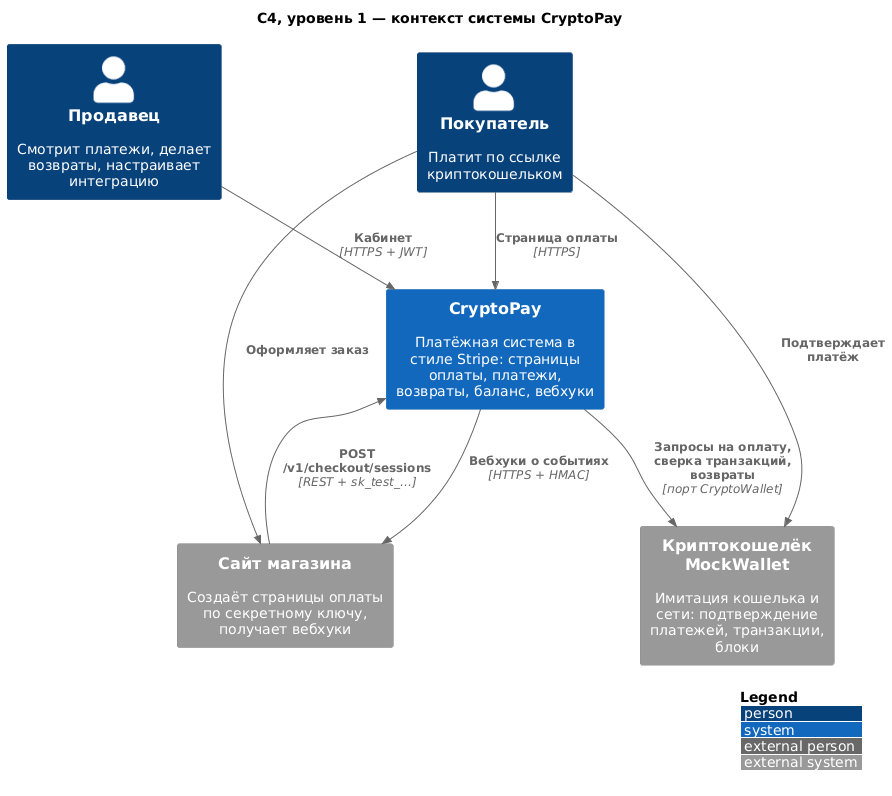

Самая простая картинка для начала защиты: CryptoPay в центре, вокруг люди и внешние системы. Без технических деталей.

## 20. C4, уровень 2 — контейнеры

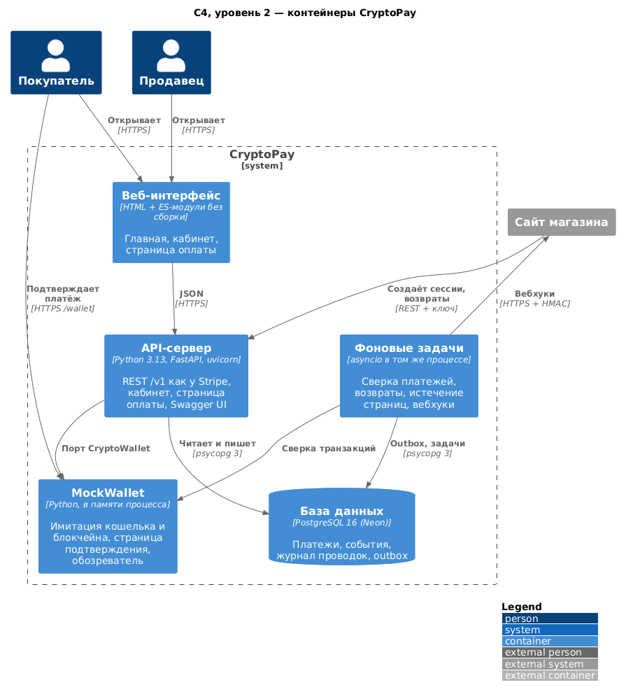

Что внутри: SPA-страницы, REST API, фоновые задачи, имитатор кошелька и база. Подписи на стрелках — протоколы и форматы.

## 21. Объекты

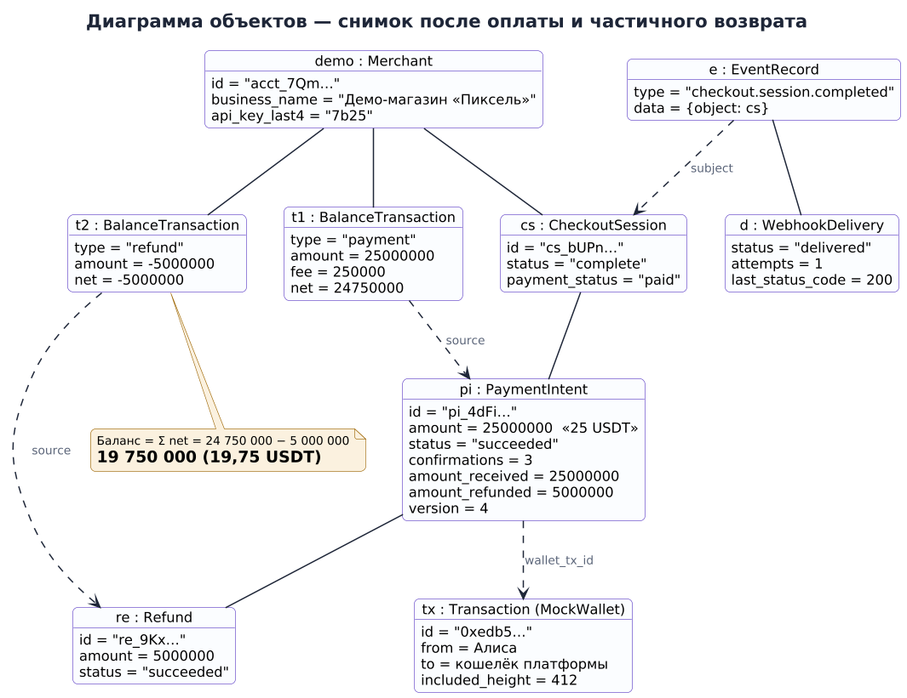

Снимок конкретных объектов после того, как покупатель оплатил 25 USDT и получил частичный возврат 5 USDT: сессия `complete`, платёж `succeeded` с `amount_refunded = 5 000 000`, две проводки (оплата +24.75 и возврат −5), событие и доставка вебхука, транзакция в MockWallet. Диаграмма объектов полезна тем, что показывает реальные значения полей — по ней легко проверить, что баланс сходится.

## 22. Временная диаграмма

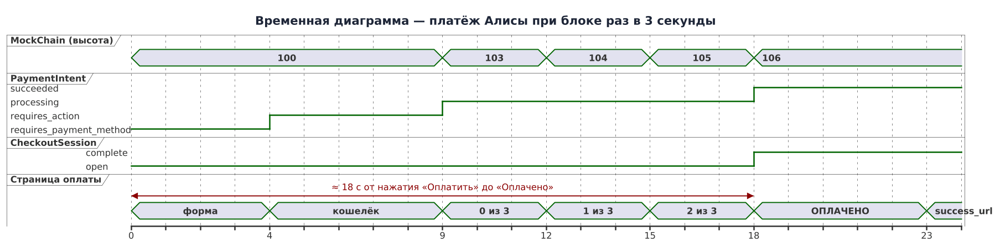

Как меняются статусы во времени при блоке раз в 3 секунды: высота MockChain, статус `PaymentIntent`, статус `CheckoutSession` и что видит покупатель на странице. От нажатия «Оплатить» до печати «Оплачено» — около 18 секунд.

## 23. Коммуникации

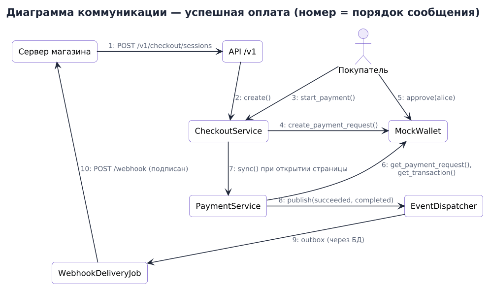

Та же успешная оплата, что на диаграммах последовательности, но акцент на **связях** между объектами, а не на времени. Номера сообщений задают порядок. Удобно, чтобы показать, что `CheckoutService` и `PaymentService` никогда не общаются с MockWallet напрямую — только через порт.

## 24. Диаграмма Ганта

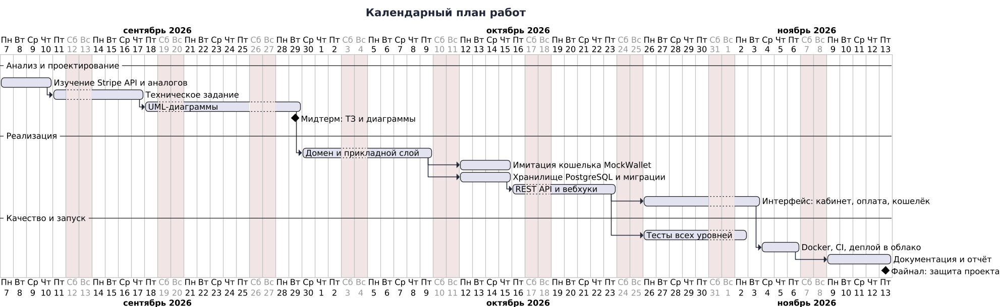

Календарный план: анализ и проектирование к мидтерму (ТЗ и диаграммы), затем реализация, тесты, деплой и документация к файналу. Даты в начале файла `24-gantt.puml` (`Project starts …`) можно поменять под ваш семестр и перерисовать.

---

## Как перерисовать

Нужна Java и `plantuml.jar` (скачивается с [plantuml.com/download](https://plantuml.com/download)):

```bash
PLANTUML_JAR=/путь/к/plantuml.jar python scripts/render_diagrams.py
```

Скрипт находит все `docs/diagrams/NN-*.puml` и кладёт PNG и SVG рядом. Без установки можно вставить текст `.puml` на [plantuml.com/plantuml](https://www.plantuml.com/plantuml) или открыть его в расширении PlantUML для VS Code / IntelliJ — но тогда в начало файла придётся вставить содержимое `_style.iuml` вместо строки `!include`.
