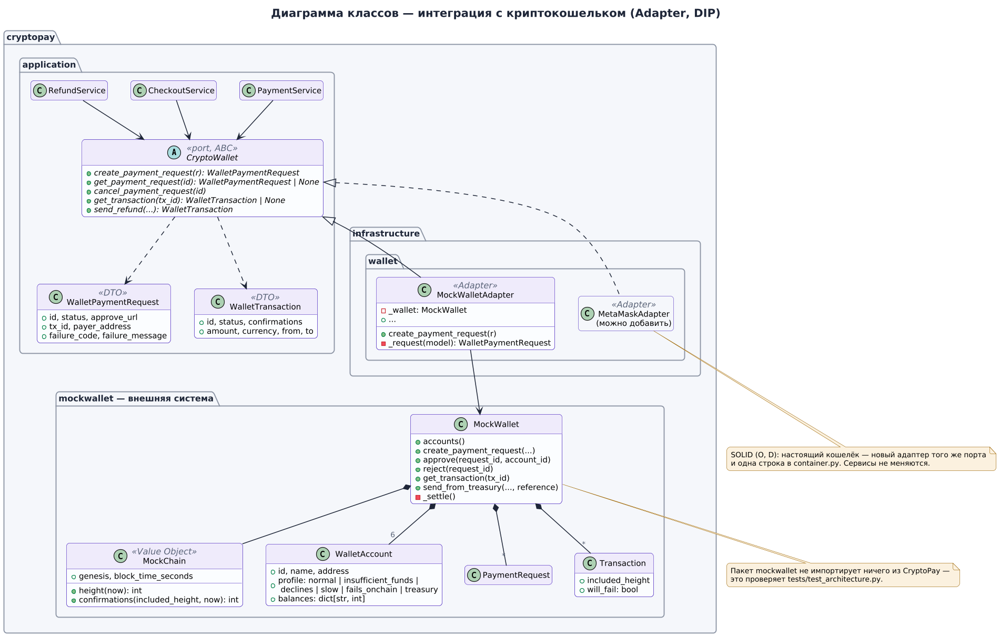
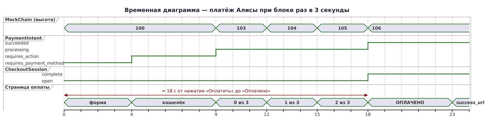

# MockWallet — имитация криптокошелька

> Коротко: вместо настоящего блокчейна у нас есть **MockWallet** — небольшая «чужая» система внутри того же процесса, которая ведёт себя как криптокошелёк и сеть: показывает покупателю окно подтверждения, «отправляет» транзакцию, складывает её в блок и считает подтверждения. CryptoPay общается с ней только через порт `CryptoWallet`, поэтому имитацию можно заменить настоящим кошельком, не трогая ни одной строчки бизнес-логики.



## Зачем имитация, а не настоящий блокчейн

Первая версия проекта работала с настоящей тестовой сетью Ethereum Sepolia и MetaMask. Работало, но на защите это превращается в лотерею:

- нужен установленный MetaMask и тестовые монеты, которые раздают «краны» с капчами и лимитами;
- блоки идут раз в 12 секунд, публичные RPC-узлы иногда перегружены — демонстрация может зависнуть на минуту;
- самое неудобное: **невозможно по заказу показать неудачный платёж**. Чтобы получить «недостаточно средств» или упавшую транзакцию, нужно специально готовить кошелёк.

Stripe решает ту же проблему тестовым режимом: ключи `sk_test_…` и тестовые карты, у каждой из которых заранее известный исход. Карта `4242 4242 4242 4242` всегда проходит, `4000 0000 0000 9995` — всегда «недостаточно средств». Мы сделали то же самое, только вместо карт — кошельки.

Важно, что от этого **не пострадала архитектура**. Задание требует «интеграции с каким-то криптокошельком», и интеграция осталась настоящей в инженерном смысле: есть внешняя система со своими моделями, ошибками и страницами, есть порт, есть адаптер, который переводит её «язык» на язык платёжной системы. Просто внешняя система не в интернете, а рядом.

## Тестовые кошельки

| Кошелёк | Что происходит при оплате | Код ошибки | Чем похоже на Stripe |
|---|---|---|---|
| **Алиса** (`alice`) | Транзакция уходит в сеть, через 3 блока платёж успешен | — | карта 4242… |
| **Боб** (`bob`) | Кошелёк сразу отвечает «недостаточно средств» (на счету 2 USDT) | `insufficient_funds` | карта …9995 |
| **Кэрол** (`carol`) | Кошелёк отклоняет платёж: «аккаунт заморожен проверкой безопасности» | `wallet_declined` | карта …0002 (generic decline) |
| **Дэйв** (`dave`) | Платёж проходит, но транзакция ждёт в «мемпуле» на 4 блока дольше | — | асинхронное подтверждение |
| **Ева** (`eve`) | Транзакция попадает в блок, но падает при выполнении (`execution reverted`), деньги возвращаются Еве | `transaction_failed` | ошибка после отправки |
| **Кошелёк платформы** (`treasury`) | Сюда приходят все оплаты, отсюда уходят возвраты | — | баланс Stripe |

Кроме того, покупатель может просто нажать **«Отклонить»** в окне кошелька — тогда платёж получит код `payment_rejected`. А если вообще ничего не делать 15 минут, запрос в кошельке истечёт (`wallet_request_expired`).

Адреса кошельков детерминированные (`0x` + первые 40 символов SHA-256 от имени), поэтому после перезапуска они не меняются, и их можно спокойно вставить в отчёт.

## Как устроена «сеть» MockChain

В настоящем блокчейне новый блок появляется по расписанию, а каждая транзакция ждёт, пока её включат в блок. Нам не хотелось запускать фоновый «майнер», поэтому высота цепочки вычисляется из времени:

```
height(now) = (now − genesis) // block_time
```

Блок 0 — момент запуска сервера, дальше по одному блоку каждые `MOCK_BLOCK_TIME_SECONDS` (3 секунды по умолчанию, в сквозных тестах — 1 секунда). Это чистая функция от времени, поэтому в unit-тестах мы просто подкручиваем подменные часы `FakeClock` и «майним» сколько угодно блоков за микросекунду.

Число подтверждений транзакции считается так же, как в Ethereum: блок, в который она попала, плюс все следующие.

```
confirmations = 0, если height < included_height
              = height − included_height + 1, иначе
```

Отправка транзакции (`_broadcast`) списывает деньги у отправителя сразу — чтобы их нельзя было потратить дважды, — а зачисляет получателю лениво, в `_settle()`, когда транзакция «легла» в блок. Если транзакция обречена (кошелёк Евы), деньги при «расчёте» возвращаются отправителю, а статус становится `failed`.



## Страницы имитатора

У MockWallet есть собственные страницы — как у настоящего кошелька есть своё окно:

| Адрес | Что это |
|---|---|
| `/wallet/approve/wpr_…` | Окно подтверждения платежа. Покупатель выбирает тестовый кошелёк и жмёт «Подтвердить» или «Отклонить». Это аналог окна 3-D Secure у карт: платёжная система отправляет покупателя туда и ждёт его возвращения. |
| `/wallet` | «Обозреватель блоков» MockChain: высота сети, балансы всех тестовых кошельков, последние транзакции с подтверждениями. На защите удобно держать открытым во второй вкладке. |

Роутер имитатора (`cryptopay/mockwallet/router.py`) подключается в `app.py` и **скрыт из Swagger** — это не часть API платёжной системы, а «чужой сайт».

## Граница: что знает CryptoPay и что знает кошелёк

Пакет `cryptopay/mockwallet` нарочно ничего не импортирует из CryptoPay — ни домен, ни сервисы. Это проверяет архитектурный тест `test_mock_wallet_knows_nothing_about_cryptopay`. Обратное тоже ограничено: напрямую с имитатором работают только три файла —

- `infrastructure/wallet/mock_wallet_adapter.py` — адаптер порта;
- `container.py` — корень композиции, который создаёт кошелёк и адаптер;
- `infrastructure/http/app.py` — подключает HTTP-страницы имитатора.

Любой другой импорт `cryptopay.mockwallet` уронит тест `test_only_the_adapter_and_composition_root_know_the_mock_wallet`.

### Порт `CryptoWallet`

```python
class CryptoWallet(ABC):
    async def create_payment_request(self, request: NewPaymentRequest) -> WalletPaymentRequest: ...
    async def get_payment_request(self, request_id: str) -> WalletPaymentRequest | None: ...
    async def cancel_payment_request(self, request_id: str) -> WalletPaymentRequest | None: ...
    async def get_transaction(self, tx_id: str) -> WalletTransaction | None: ...
    async def send_refund(self, *, reference: str, to_address: str, amount: int, currency: str) -> WalletTransaction: ...
```

Пять методов — ровно столько, сколько нужно платёжной системе: выставить запрос на оплату, узнать его судьбу, отменить, посмотреть транзакцию и отправить возврат. Порт описан словами нашего домена; слов «MetaMask», «блок» или «газ» в нём нет.

### Адаптер `MockWalletAdapter`

Переводит модели и ошибки имитатора в модели порта: `MockWalletError` становится `WalletUnavailableError` или `WalletOperationError`, `PaymentRequest` — `WalletPaymentRequest` с абсолютной ссылкой на окно подтверждения. Деньги всегда направляются на кошелёк платформы (`treasury`) — как в Stripe, где покупатель платит платформе, а та ведёт баланс продавца.

## Как заменить имитацию настоящим кошельком

1. Написать новый класс, например `CoinbaseCommerceAdapter(CryptoWallet)` или `MetaMaskSepoliaAdapter(CryptoWallet)`, рядом с `mock_wallet_adapter.py`.
2. Прогнать на нём те же сценарии — сервисы проверены на `StubWallet` из `tests/unit/test_services.py`, так что ожидания от порта уже записаны в тестах.
3. В `container.py` выбрать новый адаптер по переменной окружения.

Ни `PaymentService`, ни `CheckoutService`, ни `RefundService` при этом не меняются — это и есть принцип открытости/закрытости и инверсии зависимостей в действии (подробнее — [solid.md](solid.md)).

## Ограничения имитации

- Состояние кошелька хранится **в памяти процесса**. После перезапуска сервера балансы тестовых кошельков сбрасываются, а старые транзакции пропадают. Платежи и журнал в PostgreSQL при этом остаются — у них уже записаны итоговые статусы.
- Сервис рассчитан на один процесс (`uvicorn` без воркеров). Для учебного проекта это осознанное упрощение.
- Сеть не имитирует реорганизации цепочки (reorg) и комиссию за газ — для демонстрации платёжного процесса они не нужны, но в разделе «Развитие» отчёта они упомянуты.
- Кнопка «Сбросить тестовые балансы» в обозревателе (`POST /wallet/api/reset`) возвращает балансы к начальным — удобно перед защитой.
