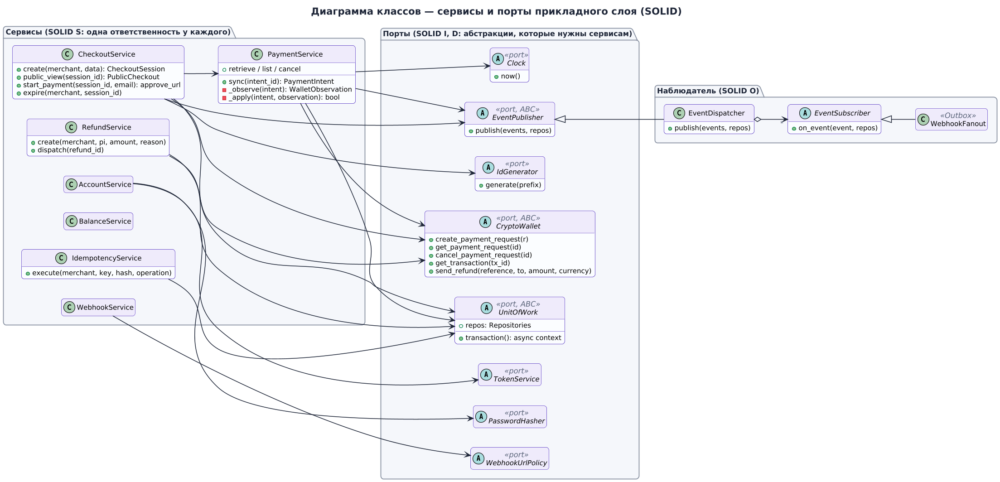
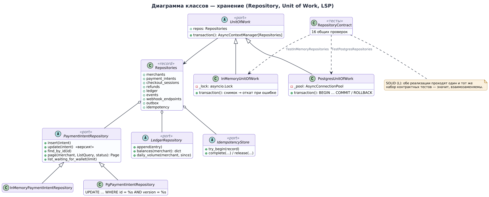
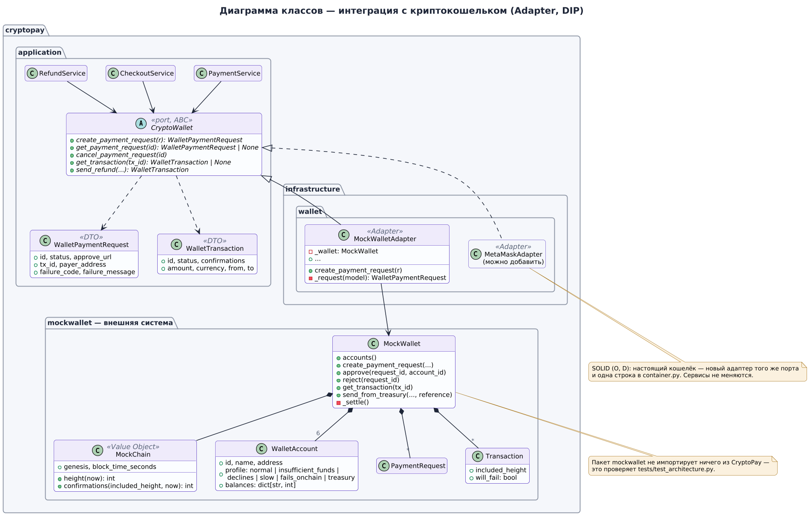

# Где в проекте SOLID

Пятый пункт задания — «где у нас элементы SOLID». Ниже каждый принцип разобран на конкретных файлах проекта: что он означает, где именно применён, что бы сломалось без него и каким тестом это подтверждается. Все пути указаны от корня репозитория.



Сводная таблица — чтобы быстро ответить на защите:

| Принцип | Самый наглядный пример | Где проверяется |
|---|---|---|
| **S** — единственная ответственность | Сервисы разделены по сценариям; подпись вебхука отделена от отправки | Каждый сервис тестируется отдельно в `tests/unit/test_services.py` |
| **O** — открытость/закрытость | Новая реакция на события — новый подписчик `EventSubscriber`; новый кошелёк — новый адаптер | Сервисы не менялись при замене блокчейна на MockWallet |
| **L** — подстановка Лисков | Репозитории в памяти и в PostgreSQL проходят один набор контрактных тестов | `tests/contract/` — 16 + 16 тестов |
| **I** — разделение интерфейсов | Порты по одному-два метода: `Clock`, `IdGenerator`, `WebhookSigner`, `EventPublisher` | Тестовые подделки в `tests/support/fakes.py` по 5–10 строк |
| **D** — инверсия зависимостей | Сервисы зависят от ABC в `application/ports`, реализации подставляет `container.py` | `tests/test_architecture.py` — 43 проверки импортов |

---

## S — Single Responsibility Principle

> У модуля должна быть одна причина для изменения.

**Сервисы по сценариям, а не один «PaymentManager».** В `cryptopay/application/services/` семь классов, и у каждого своя зона:

| Сервис | Отвечает за | Меняется, когда… |
|---|---|---|
| `CheckoutService` | создание страниц оплаты, начало оплаты, истечение | меняется процесс оформления заказа |
| `PaymentService` | сверку платежа с кошельком, отмену | меняются правила подтверждения платежа |
| `RefundService` | возвраты в две фазы | меняются правила возвратов |
| `AccountService` | регистрацию, вход, выпуск ключей | меняется авторизация |
| `BalanceService` | баланс и сводку для кабинета | меняется отчётность |
| `WebhookService` | адреса для вебхуков | меняется настройка уведомлений |
| `IdempotencyService` | повторы запросов по `Idempotency-Key` | меняется политика повторов |

Если завтра комиссия станет зависеть от валюты, правка будет в одном месте — `calculate_fee()` в `domain/ledger.py`, а `CheckoutService` об этом даже не узнает.

**Подпись отдельно от отправки.** В `application/ports/webhooks.py` три порта: `WebhookSender` (отправить HTTP-запрос), `WebhookSigner` (посчитать HMAC) и `WebhookUrlPolicy` (проверить адрес на SSRF). Можно поменять алгоритм подписи, не трогая HTTP-клиент, и наоборот.

**Формат JSON отдельно от домена.** Сущности ничего не знают о том, как они выглядят в API. Превращением `PaymentIntent` в JSON «как у Stripe» (`object`, unix-время `created`, `livemode: false`) занимается `ObjectSerializer` в `application/serializers.py`. Поменяется версия API — меняется только сериализатор.

**Фоновые задачи по одной на дело.** `PaymentSyncJob`, `RefundSyncJob`, `SessionExpiryJob`, `WebhookDeliveryJob`, `IdempotencyCleanupJob` — у каждой один метод `run()`. Планировщик (`infrastructure/scheduler.py`) не знает, что внутри задач; задачи не знают, как их запускают по таймеру.

**Сущность хранит правила, но не хранит себя.** `PaymentIntent` знает, в какие статусы можно перейти и сколько денег можно вернуть, но не знает про SQL. Сохранением занимаются репозитории.

## O — Open/Closed Principle

> Модуль открыт для расширения, но закрыт для изменения.

**Подписчики на события.** `EventDispatcher` (`application/events/dispatcher.py`) раздаёт каждое событие списку подписчиков:

```python
class EventSubscriber(ABC):
    name: str

    @abstractmethod
    async def on_event(self, event: EventRecord, repos: Repositories) -> None: ...
```

Сейчас подписчик один — `WebhookFanout`, который ставит вебхуки в очередь. Хотим отправлять покупателю письмо об оплате — пишем `EmailReceiptSubscriber` и добавляем его одной строкой в `container.py`:

```python
publisher = EventDispatcher(ids=ids, serializer=serializer, subscribers=[WebhookFanout(ids), EmailReceiptSubscriber(...)])
```

Ни `PaymentService`, ни `PaymentIntent`, ни `EventDispatcher` при этом не меняются.

**Кошельки.** Порт `CryptoWallet` — точка расширения. Когда проект переходил с настоящей сети Sepolia на имитацию MockWallet, сервисы платежей не поменялись: добавился новый адаптер `MockWalletAdapter`, а `container.py` стал создавать его вместо старого. Подключение, скажем, Coinbase Commerce — это ещё один класс-наследник `CryptoWallet`.

**Валюты.** Список валют — данные, а не код: `application/currencies.py`. Добавить USDT в другой сети — одна строка `Currency(code=…, decimals=…, min_amount=…)`.

**Хранилище.** `UnitOfWork` имеет две реализации — `InMemoryUnitOfWork` и `PostgresUnitOfWork`. Третья (например, SQLite) добавляется без изменений в сервисах.

**Конечный автомат как данные.** Разрешённые переходы `PaymentIntent` описаны словарём `_TRANSITIONS`. Новый статус — это новая строка в словаре и метод перехода, а не новая ветка `if` в десяти местах.

## L — Liskov Substitution Principle

> Объект подкласса должен работать везде, где ожидается объект базового класса, без сюрпризов.

Это единственный принцип, который мы проверяем **автоматически и явно**.



В `tests/contract/repository_contract.py` лежит класс `RepositoryContract` с тестами поведения репозиториев: пагинация по курсору, оптимистическая блокировка, уникальность `wallet_tx_id`, атомарность транзакции, идемпотентность `try_begin`, баланс как сумма проводок и т. д. От него наследуются два тестовых класса:

```python
# tests/contract/test_memory.py
class TestInMemoryRepositories(RepositoryContract):
    ...  # фикстура отдаёт InMemoryUnitOfWork

# tests/contract/test_postgres.py
class TestPostgresRepositories(RepositoryContract):
    ...  # фикстура отдаёт PostgresUnitOfWork поверх настоящей базы
```

Обе реализации проходят **одни и те же 16 тестов**. Значит, любой сервис, которому дали `UnitOfWork`, не заметит разницы, — и именно поэтому интеграционные тесты могут работать в памяти, а production — на PostgreSQL.

Ещё примеры подстановки, на которых держатся тесты:

| Порт | В production | В тестах |
|---|---|---|
| `Clock` | `SystemClock` | `FakeClock` — время двигается вручную, блоки MockChain «майнятся» мгновенно |
| `IdGenerator` | `RandomIdGenerator` | `SequentialIds` — `pi_test000000000001`, `cs_test000000000002`… для читаемых проверок |
| `PasswordHasher` | `ScryptPasswordHasher` | `PlainPasswordHasher` — чтобы тесты не тратили время на scrypt |
| `WebhookSender` | `HttpxWebhookSender` | `RecordingWebhookSender` — записывает запросы, умеет «падать» по заказу |
| `CryptoWallet` | `MockWalletAdapter` | `StubWallet` — отдаёт заранее заданные ответы |

Чтобы подстановка была честной, контракт описан не только сигнатурой, но и поведением: например, `update()` у обеих реализаций **обязан** бросить `ConcurrencyError`, если версия объекта устарела. Реализация, которая молча перезапишет данные, формально подходит по типам, но нарушает LSP — и контрактный тест это поймает.

## I — Interface Segregation Principle

> Клиент не должен зависеть от методов, которыми не пользуется.

Порты в `application/ports/` намеренно мелкие:

```python
class Clock(ABC):
    def now(self) -> datetime: ...

class IdGenerator(ABC):
    def generate(self, prefix: IdPrefix) -> str: ...

class Hasher(ABC):
    def sha256(self, value: str) -> str: ...

class WebhookSigner(ABC):
    def sign(self, secret: str, timestamp: int, body: str) -> str: ...
```

Благодаря этому тестовая подделка — это 5–10 строк, а не класс с двадцатью заглушками.

**Публикация отдельно от подписки.** Сервисам нужен только метод `publish()`, поэтому они зависят от `EventPublisher`, а не от `EventDispatcher` целиком. Им не видно, как регистрируются подписчики.

**Репозиторий на агрегат, а не один на всё.** Вместо «большого DAO» с пятьюдесятью методами — `MerchantRepository`, `PaymentIntentRepository`, `CheckoutSessionRepository`, `RefundRepository`, `LedgerRepository`, `EventRepository`, `WebhookEndpointRepository`, `WebhookOutbox`, `IdempotencyStore`. `BalanceService` пользуется только `LedgerRepository` и не видит методов для вебхуков.

**Кошелёк — пять методов.** `CryptoWallet` описывает только то, что нужно платёжной системе. Обозреватель блоков, балансы тестовых аккаунтов и сброс сети — это возможности MockWallet, но в порт они не попали: платёжной системе они не нужны.

**Авторизация.** `TokenService` (выдать и проверить токен сессии) и `PasswordHasher` (хэш и проверка пароля) — разные порты, хотя оба про безопасность. `AccountService` использует оба, а например `WebhookService` — ни одного.

## D — Dependency Inversion Principle

> Модули верхнего уровня не зависят от модулей нижнего уровня. Оба зависят от абстракций.



Посмотрите на конструктор `PaymentService`:

```python
class PaymentService:
    def __init__(self, *, uow: UnitOfWork, clock: Clock, ids: IdGenerator,
                 wallet: CryptoWallet, publisher: EventPublisher, config: PaymentConfig) -> None:
```

Здесь нет ни `psycopg`, ни `MockWallet`, ни `datetime.now()`. Всё, от чего зависит сервис, — абстракции из `application/ports`. Конкретные классы выбирает **корень композиции** `cryptopay/container.py`:

```python
uow, storage = PostgresUnitOfWork(pool), "postgres"        # или InMemoryUnitOfWork()
wallet: CryptoWallet = o.wallet or MockWalletAdapter(mock_wallet, public_url=config.public_url)
publisher = EventDispatcher(ids=ids, serializer=serializer, subscribers=[WebhookFanout(ids)])
payments = PaymentService(uow=uow, clock=clock, ids=ids, wallet=wallet, publisher=publisher, config=...)
```

Стрелка зависимости развёрнута: не «сервис → MockWallet», а «сервис → `CryptoWallet` ← `MockWalletAdapter` → MockWallet». Абстракцию определяет тот, кто ею пользуется (прикладной слой), а не тот, кто её реализует.

**Правило закреплено тестом.** `tests/test_architecture.py` разбирает импорты каждого `.py`-файла через модуль `ast` и проверяет:

- `domain` импортирует только себя и «чистую» стандартную библиотеку;
- `application` — только `domain` и себя, никаких `fastapi`, `psycopg`, `httpx`, `os`, `logging`, `hashlib`;
- `mockwallet` не знает о CryptoPay вообще;
- имитатор кошелька импортируют только адаптер, `container.py` и `app.py`.

Это «фитнес-функция» архитектуры: если кто-то в спешке вставит `import psycopg` в сервис, CI упадёт с понятным сообщением вроде `services/payment_service.py импортирует {'psycopg'}`.

**Что это дало на практике.** `ContainerOverrides` позволяет тестам подменить часы, генератор id, хранилище, отправщик вебхуков и кошелёк. Поэтому интеграционный тест «оплата → 3 подтверждения → вебхук с правильной подписью» проходит за доли секунды: время двигается вручную, блоки «майнятся» мгновенно, а вебхуки записываются в список вместо сети.

---

## Паттерны проектирования рядом с SOLID

SOLID — это принципы, а реализуются они через паттерны. В проекте используются:

| Паттерн | Где | Какой принцип поддерживает |
|---|---|---|
| **Adapter** | `MockWalletAdapter`, `HttpxWebhookSender`, `PostgresUnitOfWork` | D, O |
| **Repository** | `application/ports/repositories.py` + две реализации | S, L |
| **Unit of Work** | `UnitOfWork.transaction()` | S |
| **Observer** | `EventDispatcher` → `EventSubscriber` | O, I |
| **Transactional Outbox** | `WebhookFanout` + `WebhookDeliveryJob` | S |
| **State** (конечный автомат) | `PaymentIntent._TRANSITIONS`, статусы `CheckoutSession` и `Refund` | O |
| **Strategy** | `WebhookUrlPolicy` (разрешать http в разработке или нет), `PasswordHasher` | O, D |
| **Factory Method** | `PaymentIntent.create()`, `BalanceTransaction.for_payment()` / `for_refund()` | S |
| **Composition Root / DI** | `container.py`, `ContainerOverrides` | D |
| **Value Object** | `Currency`, `PaymentError`, `DomainEvent`, `BalanceTransaction` | S |
| **Idempotency Key** | `IdempotencyService`, отправка возвратов по `reference` | — (надёжность) |
| **Optimistic Locking** | поле `version` + `UPDATE … WHERE version = …` | — (надёжность) |
