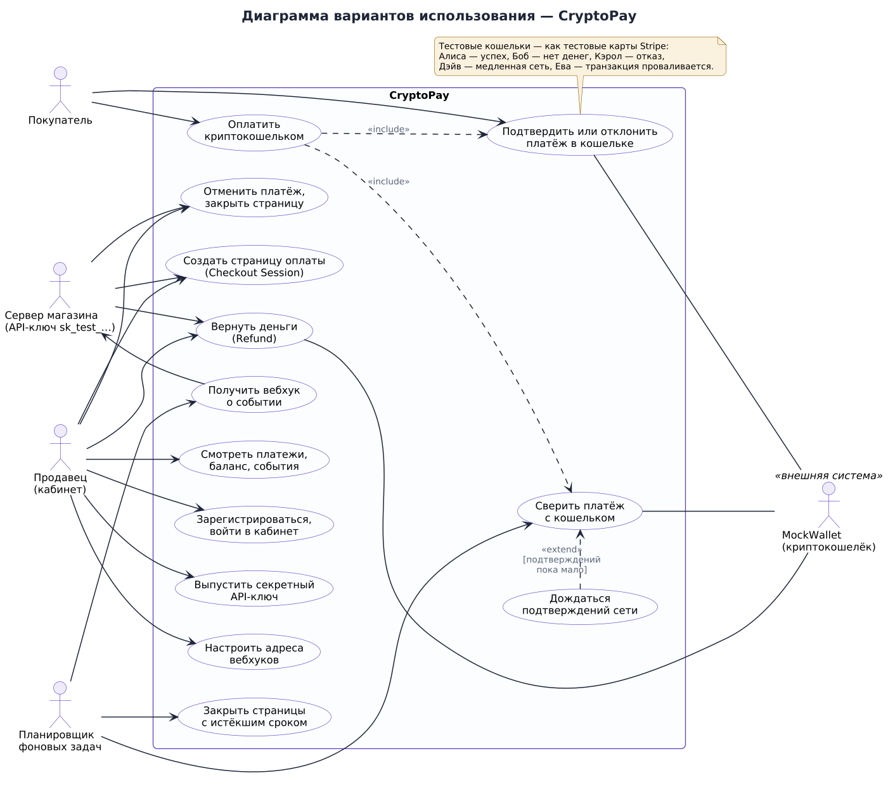

# Техническое задание

## на разработку платёжной системы для криптокошелька «CryptoPay»

*Структура документа следует ГОСТ 34.602-2020 «Техническое задание на создание автоматизированной системы», сокращённой до объёма учебного проекта.*

---

## 1. Общие сведения

**1.1. Наименование системы.** Платёжная система для криптокошелька «CryptoPay» (далее — Система).

**1.2. Основание для разработки.** Задание по дисциплине «Advanced Software» (мидтерм и файнал): разработать платёжную систему для криптокошелька, подготовить техническое задание и UML-диаграммы, развернуть систему на облачном сервере, интегрировать с криптокошельком и показать применение принципов SOLID.

**1.3. Исполнитель.** [ФИО студента], группа [номер группы].
**Руководитель.** [ФИО преподавателя].

**1.4. Сроки.** Первый этап (мидтерм) — техническое задание и UML-диаграммы. Второй этап (файнал) — работающая Система в облаке, тесты, документация и защита. Календарный план — диаграмма Ганта `docs/diagrams/png/24-gantt.png`.

**1.5. Прототип.** Платформа Stripe (stripe.com): модель объектов (PaymentIntent, Checkout Session, Refund, Balance Transaction, Event, Webhook Endpoint), формат REST API, механизм идемпотентности и подписи вебхуков. Система воспроизводит эту модель для приёма криптовалюты.

**1.6. Режим работы.** Система работает только в **тестовом режиме**, аналогичном тестовому режиму Stripe: реальные деньги не перемещаются, вместо настоящего блокчейна используется имитация кошелька и сети MockWallet с набором тестовых кошельков, у каждого из которых заранее известен исход платежа.

## 2. Назначение и цели создания Системы

**2.1. Назначение.** Система позволяет интернет-магазину принимать оплату в криптовалюте так же просто, как картой через Stripe: сервер магазина создаёт страницу оплаты одним запросом, покупатель платит криптокошельком, а магазин получает подписанное уведомление (вебхук) об оплате.

**2.2. Цели.**

1. Дать продавцу единый способ принимать USDT, USDC, BTC и ETH без самостоятельной работы с блокчейном.
2. Гарантировать, что один платёж не будет засчитан дважды и не будет засчитан без достаточного числа подтверждений сети.
3. Дать покупателю понятную страницу оплаты с прогрессом подтверждений и возможностью повторить неудачную попытку.
4. Продемонстрировать архитектуру, в которой криптокошелёк подключён через абстракцию и может быть заменён без изменения бизнес-логики (принципы SOLID).

**2.3. Критерии достижения целей.** Все функциональные требования раздела 4.2 покрыты автоматическими тестами; Система доступна по публичному HTTPS-адресу; полный сценарий «создание страницы → оплата → вебхук → возврат» выполняется в браузере.

## 3. Характеристика объекта автоматизации

**3.1. Предметная область.** Приём онлайн-платежей. В классической схеме между покупателем и магазином стоит платёжный провайдер: он показывает форму оплаты, общается с банком (здесь — с криптокошельком и сетью), ведёт баланс продавца и уведомляет магазин о событиях.

**3.2. Особенности криптоплатежей**, которые учитывает Система:

- платёж подтверждается не мгновенно, а по мере появления новых блоков сети; до набора нужного числа подтверждений он считается незавершённым;
- суммы имеют разную точность: 6 знаков у USDT/USDC, 8 у BTC, 18 у ETH, — поэтому их нельзя хранить в числах с плавающей точкой;
- транзакция может провалиться уже после отправки в сеть;
- платёж и возврат — операции в двух разных системах без общей транзакции.

**3.3. Участники (роли).**

| Роль | Описание | Как взаимодействует |
|---|---|---|
| Покупатель | Платит за заказ | Страница оплаты, окно кошелька |
| Продавец | Владелец магазина | Личный кабинет |
| Сервер магазина | Программа продавца | REST API с секретным ключом, приём вебхуков |
| Криптокошелёк | Внешняя система (MockWallet) | Через порт `CryptoWallet` |
| Планировщик | Таймер фоновых задач | Сверка, истечение, доставка вебхуков |

## 4. Требования к Системе

### 4.1. Требования к Системе в целом

**4.1.1. Архитектура.**

- Система строится по гексагональной архитектуре: слой домена, прикладной слой с портами-интерфейсами и слой инфраструктуры с адаптерами.
- Доменный и прикладной слои не зависят от веб-фреймворка, базы данных и кошелька. Правило зависимостей проверяется автоматическим тестом.
- Криптокошелёк подключается через порт `CryptoWallet`; имитация MockWallet — независимый модуль, не импортирующий код Системы.
- В коде должны прослеживаться все пять принципов SOLID (см. раздел 4.5).

**4.1.2. Надёжность.**

- Изменение платежа, запись в журнал баланса, события и постановка вебхуков в очередь выполняются в одной транзакции БД.
- Параллельная обработка одного платежа не приводит к двойному зачислению (оптимистическая блокировка и ограничения уникальности в БД).
- Повтор запроса на создание объекта с тем же `Idempotency-Key` не создаёт второй объект.
- Сбой доставки вебхука не влияет на приём платежа; доставка повторяется с нарастающей задержкой.
- Перезапуск сервера не приводит к потере платежей: незавершённые платежи и возвраты дорабатываются фоновыми задачами.

**4.1.3. Безопасность.** Требования — в разделе 4.4.

**4.1.4. Эргономика.**

- Интерфейс на русском языке.
- Сообщения об ошибках объясняют, что произошло и что делать дальше («Недостаточно средств в кошельке — выберите другой кошелёк»).
- Покупатель видит прогресс подтверждений сети («2 из 3»).

**4.1.5. Переносимость.** Система запускается одной командой на любой платформе с Python 3.12+ или Docker; при отсутствии PostgreSQL работает с хранением в памяти.

### 4.2. Функциональные требования

Приоритеты: **О** — обязательное, **Ж** — желательное.

#### Аккаунт продавца

| ID | Требование | Пр. |
|---|---|---|
| FR-01 | Продавец регистрируется по e-mail, паролю (8–128 символов) и названию магазина; e-mail уникален | О |
| FR-02 | Продавец входит в кабинет по e-mail и паролю; сессия действует ограниченное время | О |
| FR-03 | Продавец выпускает секретный ключ `sk_test_…`; ключ показывается один раз, выпуск нового отзывает старый | О |
| FR-04 | Продавец меняет название магазина, которое видит покупатель | Ж |
| FR-05 | Для демонстрации при запуске создаётся демо-аккаунт и кнопка «Попробовать оплату» | Ж |

#### Страницы оплаты (Checkout Session)

| ID | Требование | Пр. |
|---|---|---|
| FR-10 | Сервер магазина создаёт страницу оплаты: сумма в минимальных единицах, валюта, описание, `success_url`, `cancel_url`, `metadata`, срок жизни 5–1440 минут | О |
| FR-11 | Вместе со страницей создаётся платёж (PaymentIntent) в статусе `requires_payment_method` | О |
| FR-12 | Поддерживаются валюты USDT, USDC, BTC, ETH; суммы ниже минимальной отклоняются | О |
| FR-13 | Продавец создаёт платёжную ссылку из кабинета, вводя сумму в обычных единицах (например, 12.5) | Ж |
| FR-14 | Страница с истёкшим сроком закрывается автоматически, её платёж отменяется | О |
| FR-15 | Продавец может закрыть страницу досрочно | О |
| FR-16 | В `success_url` подставляется id сессии вместо `{CHECKOUT_SESSION_ID}` | Ж |

#### Оплата

| ID | Требование | Пр. |
|---|---|---|
| FR-20 | Покупатель видит магазин, описание, сумму, валюту и срок; может указать e-mail для чека | О |
| FR-21 | По кнопке «Оплатить» Система создаёт запрос на оплату в кошельке и переводит покупателя в окно кошелька | О |
| FR-22 | В окне кошелька покупатель подтверждает или отклоняет платёж | О |
| FR-23 | Платёж считается успешным, только когда транзакция подтверждена сетью не менее `REQUIRED_CONFIRMATIONS` раз (по умолчанию 3) | О |
| FR-24 | Сумма и валюта транзакции сверяются с платежом; при расхождении платёж не засчитывается | О |
| FR-25 | Неудачная попытка (отказ, недостаточно средств, отклонение кошельком, провал транзакции, истечение запроса) возвращает платёж в `requires_payment_method` с понятной причиной; покупатель может повторить | О |
| FR-26 | Страница оплаты показывает прогресс подтверждений и после оплаты — отметку «Оплачено» и ссылку на `success_url` | О |
| FR-27 | Продавец может отменить неоплаченный платёж; отмена невозможна, если покупатель уже подтвердил платёж в кошельке | О |
| FR-28 | Фоновая задача сверяет незавершённые платежи, даже если покупатель закрыл страницу | О |

#### Возвраты

| ID | Требование | Пр. |
|---|---|---|
| FR-30 | Продавец возвращает оплаченный платёж полностью или частично, в том числе несколькими возвратами | О |
| FR-31 | Сумма возвратов не превышает полученную сумму и доступный баланс продавца | О |
| FR-32 | Возврат отправляется на адрес, с которого пришла оплата; повторная отправка не приводит к двойному переводу | О |
| FR-33 | Неудачный возврат восстанавливает баланс продавца и возвращаемый остаток платежа | О |

#### Баланс

| ID | Требование | Пр. |
|---|---|---|
| FR-40 | Каждая оплата и возврат отражаются проводкой в журнале баланса (сумма, комиссия, чистыми) | О |
| FR-41 | С каждой оплаты удерживается комиссия платформы (`PLATFORM_FEE_BPS`, по умолчанию 1 %), округление вверх; при возврате комиссия не возвращается | О |
| FR-42 | Баланс продавца по каждой валюте равен сумме проводок | О |
| FR-43 | Главная кабинета показывает баланс, оборот за 7 дней и число платежей по статусам | Ж |

#### События и вебхуки

| ID | Требование | Пр. |
|---|---|---|
| FR-50 | Каждое изменение платежа, сессии и возврата записывается в журнал событий со снимком объекта | О |
| FR-51 | Продавец добавляет до 5 адресов для вебхуков и выбирает события; каждому адресу выдаётся секрет `whsec_…` | О |
| FR-52 | Вебхук подписывается HMAC-SHA256 с меткой времени в заголовке `cryptopay-signature` | О |
| FR-53 | Недоставленный вебхук повторяется через 1 мин, 5 мин, 15 мин, 1 ч, 6 ч; после 6 попыток помечается неудачным | О |
| FR-54 | Продавец видит историю попыток доставки и может отправить тестовое событие | Ж |

#### API

| ID | Требование | Пр. |
|---|---|---|
| FR-60 | REST API `/v1` в стиле Stripe: объекты с полем `object`, время в unix-секундах, списки `{object: "list", data, has_more}` | О |
| FR-61 | Курсорная пагинация (`limit`, `starting_after`) | О |
| FR-62 | Единый формат ошибок `{"error": {type, code, message, param}}` | О |
| FR-63 | Заголовок `Idempotency-Key` для всех `POST`; повтор возвращает сохранённый ответ с заголовком `Idempotent-Replayed` | О |
| FR-64 | Авторизация ключом через `Authorization: Bearer` и Basic (`-u sk_test_…:`) | О |
| FR-65 | Интерактивная документация OpenAPI (Swagger UI) | О |

#### Имитация кошелька

| ID | Требование | Пр. |
|---|---|---|
| FR-70 | MockWallet имитирует сеть: блок появляется каждые `MOCK_BLOCK_TIME_SECONDS` секунд, подтверждения считаются по высоте | О |
| FR-71 | Есть тестовые кошельки с заранее известным исходом: успех, недостаточно средств, отказ кошелька, медленная сеть, провал транзакции | О |
| FR-72 | Окно подтверждения платежа и обозреватель сети с балансами и транзакциями | О |
| FR-73 | Платежи поступают на кошелёк платформы, возвраты отправляются с него | О |
| FR-74 | Запрос на оплату в кошельке истекает через 15 минут | Ж |

### 4.3. Нефункциональные требования

| ID | Требование |
|---|---|
| NFR-01 | Суммы хранятся и передаются как целые числа минимальных единиц без потери точности (до 30 цифр); в JSON — строкой |
| NFR-02 | Ответ API на создание страницы оплаты — не дольше 500 мс без учёта сети (на бесплатном хостинге) |
| NFR-03 | Покупатель видит смену статуса не позже чем через 2 секунды после изменения (опрос страницы) |
| NFR-04 | Система доступна по HTTPS на публичном адресе |
| NFR-05 | Покрытие автоматическими тестами всех обязательных требований раздела 4.2 |
| NFR-06 | Код проходит проверку типов `mypy --strict` и линтер без замечаний |
| NFR-07 | Запуск с нуля одной командой (`docker compose up` или `python -m cryptopay`) |

### 4.4. Требования к безопасности

| ID | Требование |
|---|---|
| SEC-01 | Пароли хранятся в виде хэша scrypt с уникальной солью |
| SEC-02 | Секретные ключи хранятся в виде SHA-256; в интерфейсе показываются последние 4 символа |
| SEC-03 | Продавец не видит объекты других продавцов; запрос чужого объекта возвращает 404 |
| SEC-04 | Ограничение частоты запросов на вход, оплату и действия в кошельке |
| SEC-05 | Адрес вебхука не может указывать на внутренние адреса (защита от SSRF); в production — только `https` |
| SEC-06 | Заголовки безопасности: CSP без `unsafe-inline`, `X-Frame-Options: DENY`, HSTS в production |
| SEC-07 | Размер тела запроса ограничен 32 КБ, длина всех полей ограничена |
| SEC-08 | Ключом API нельзя управлять аккаунтом (только сессией кабинета) |

### 4.5. Требования к применению SOLID

| Принцип | Требование |
|---|---|
| S | Бизнес-сценарии разделены по отдельным сервисам; форматирование ответов, подпись и отправка вебхуков — отдельные классы |
| O | Новая реакция на события и новый кошелёк добавляются новым классом без изменения существующих сервисов |
| L | Реализации хранилища в памяти и в PostgreSQL проходят один набор контрактных тестов |
| I | Порты содержат только методы, нужные их клиентам |
| D | Сервисы зависят от абстракций; конкретные реализации выбираются в корне композиции |

### 4.6. Требования к видам обеспечения

**Информационное.** Хранилище — PostgreSQL 16; схема создаётся миграциями автоматически при запуске. Таблицы: продавцы, платежи, страницы оплаты, возвраты, проводки, события, адреса вебхуков, доставки, ключи идемпотентности. Целостность обеспечивается внешними ключами и CHECK-ограничениями.

**Программное.** Python 3.13, FastAPI, Pydantic, psycopg 3, PyJWT, httpx, uvicorn. Интерфейс — HTML, CSS и JavaScript (ES-модули) без сборщика. Тесты — pytest, Playwright.

**Техническое.** Облачный хостинг с поддержкой Docker (Render, план Free) и управляемая база PostgreSQL (Neon, план Free). Альтернатива — любой VPS с Docker. Развёрнутая версия: https://cryptopay-u2rc.onrender.com.

## 5. Состав и содержание работ

| Этап | Работы | Результат |
|---|---|---|
| 1. Анализ | Изучение Stripe API и предметной области | Модель объектов |
| 2. Проектирование | ТЗ, UML-диаграммы | Этот документ, 24 диаграммы — **мидтерм** |
| 3. Реализация | Домен, прикладной слой, MockWallet, PostgreSQL, API, интерфейс | Исходный код |
| 4. Тестирование | Unit, архитектурные, контрактные, интеграционные, сквозные тесты | 221 тест, CI |
| 5. Внедрение | Docker, развёртывание в облаке | Публичный адрес |
| 6. Документация и защита | Отчёт, руководства, шпаргалка | Отчёт — **файнал** |

## 6. Порядок контроля и приёмки

Приёмка проводится демонстрацией на развёрнутой Системе и запуском автоматических тестов.

| № | Проверка | Ожидаемый результат | Требования |
|---|---|---|---|
| 1 | Открыть `/healthz` | `status: ok`, `storage: postgres` | NFR-04 |
| 2 | Главная → «Попробовать оплату» → Алиса → подтвердить | Через ~10 с отметка «Оплачено» | FR-10…FR-26 |
| 3 | Оплатить кошельком Боба, затем Алисы | Ошибка «Недостаточно средств», затем успешная оплата | FR-25 |
| 4 | Оплатить кошельком Евы | «Транзакция не прошла в сети», платёж можно повторить | FR-25 |
| 5 | Кабинет → платёж → вернуть 5 USDT | Возврат «Возвращён», баланс уменьшился на 5 | FR-30…FR-33, FR-40…FR-42 |
| 6 | Создать сессию через `curl` с `Idempotency-Key` дважды | Один и тот же `id`, заголовок `Idempotent-Replayed: true` | FR-63 |
| 7 | Пример магазина `examples/shop.py`: купить → оплатить | Заказ отмечен оплаченным по вебхуку | FR-50…FR-53 |
| 8 | Открыть `/docs` | Swagger UI со всеми методами | FR-65 |
| 9 | `pytest` и `RUN_E2E=1 pytest tests/e2e` | Все тесты проходят | NFR-05 |
| 10 | Показать порт `CryptoWallet` и адаптер; архитектурный тест | Сервисы не зависят от MockWallet | 4.1.1, 4.5 |

Матрица соответствия требований тестам — в приложении Б.

## 7. Требования к документации

| Документ | Файл |
|---|---|
| Техническое задание | `docs/TZ.md` (этот документ) |
| Отчёт о выполнении | `docs/REPORT.md` |
| UML-диаграммы с описаниями | `docs/diagrams.md`, исходники `docs/diagrams/*.puml` |
| Описание архитектуры | `docs/architecture.md` |
| Описание имитации кошелька | `docs/mock-wallet.md` |
| Применение SOLID | `docs/solid.md` |
| Справочник API | `docs/api.md`, Swagger UI `/docs` |
| Руководство по развёртыванию | `docs/deployment.md` |
| Описание тестирования | `docs/testing.md` |
| Безопасность | `docs/security.md` |
| Шпаргалка к защите | `docs/DEFENSE.md` |

## 8. Источники разработки

1. ГОСТ 34.602-2020. Информационные технологии. Комплекс стандартов на автоматизированные системы. Техническое задание на создание автоматизированной системы.
2. Stripe API Reference — docs.stripe.com/api.
3. Stripe Docs: Idempotent requests; Checkout Sessions; Webhooks — проверка подписи.
4. Martin R. C. Clean Architecture. — Prentice Hall, 2017.
5. Cockburn A. Hexagonal Architecture (Ports and Adapters), 2005.
6. Richardson C. Microservices Patterns: Transactional Outbox. — Manning, 2018.
7. OWASP Top 10 и OWASP Cheat Sheet Series: Password Storage, SSRF Prevention.

---

## Приложение А. Глоссарий

| Термин | Значение |
|---|---|
| Checkout Session | Страница оплаты с суммой, сроком жизни и адресами возврата в магазин |
| PaymentIntent | Объект платежа: «намерение получить деньги», проходит через статусы до `succeeded` |
| Подтверждение (confirmation) | Число блоков сети, включая блок с транзакцией, после её попадания в цепочку |
| Минимальная единица | Наименьшая доля валюты: 1 USDT = 10⁶ единиц, 1 BTC = 10⁸ сатоши, 1 ETH = 10¹⁸ wei |
| Вебхук | HTTP-запрос от Системы на сервер магазина о событии |
| Идемпотентность | Свойство операции: повторное выполнение даёт тот же результат, что и однократное |
| Порт | Интерфейс, через который прикладной слой обращается к внешнему миру |
| Адаптер | Класс, реализующий порт для конкретной технологии |
| MockWallet | Имитация криптокошелька и сети для тестового режима |
| Базисный пункт (bps) | 0,01 %; 100 bps = 1 % |

## Приложение Б. Матрица трассировки

| Требования | Диаграммы | Тесты |
|---|---|---|
| FR-01…FR-05 | 01 | `test_services.py::test_register_login_and_api_key`, `test_api.py::test_register_login_and_account`, e2e `test_dashboard_payment_link_and_developers` |
| FR-10…FR-16 | 02, 06, 14 | `test_domain.py` (TestCheckoutSession), `test_api.py::test_cancel_and_expire`, `test_services.py::test_session_expiry_cancels_intent_and_wallet_request` |
| FR-20…FR-28 | 07, 11, 12, 13, 22, 23 | `test_services.py::test_payment_succeeds_after_required_confirmations`, `test_wallet_refusals_become_payment_errors`, `test_server_does_not_trust_the_wallet`, e2e — 5 сценариев оплаты |
| FR-30…FR-33 | 09, 14, 21 | `test_services.py::test_partial_and_full_refund`, `test_refund_failure_restores_balance`, e2e `test_dashboard_refund` |
| FR-40…FR-43 | 02, 18, 21 | `test_domain.py::TestLedger`, контракт `test_ledger_balances_and_one_payment_entry` |
| FR-50…FR-54 | 08, 14 | `test_services.py::test_webhooks_respect_subscriptions_and_are_signed`, `test_webhook_retries_with_backoff_then_gives_up`, e2e `test_shop_integration_with_webhook` |
| FR-60…FR-65 | 06, 10 | `test_api.py` — 25 тестов, e2e `test_swagger_ui_works_under_strict_csp` |
| FR-70…FR-74 | 04, 22 | `test_mockwallet.py` — 15 тестов, e2e `test_mockchain_explorer_shows_the_payment` |
| SEC-01…SEC-08 | 15 | `test_api.py::test_security_headers`, `test_body_size_limit`, `test_rate_limit_on_login`, `test_other_merchant_objects_are_invisible`, `test_api_key_cannot_manage_account` |
| 4.1.1, 4.5 (SOLID) | 03, 04, 05, 15, 17 | `test_architecture.py` — 43 теста, `tests/contract` — 32 теста |
